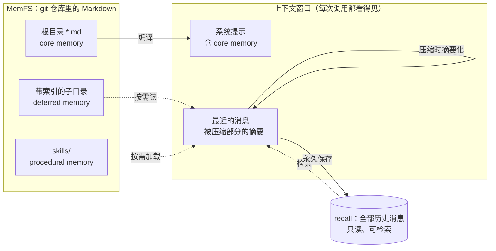

# 第 1 章 Agent 为什么需要记忆

> 本章目标：说清楚“agent 的记忆”到底是什么、分几种、各自放在哪里，以及 letta-code 用什么心智模型来组织它们。前置：第 0 章。对应代码：mini-letta `v0.1`。

## 1.1 模型不记事，harness 记事

一次 LLM 调用的全部输入是：

```text
系统提示（system）+ 消息列表（messages）+ 工具定义（tools）  →  模型  →  回复 / 工具调用
```

调用结束，模型什么都不留下。下一次调用时它“知道”的一切，都必须重新出现在这三样东西里。所以“记忆”这个词在 agent 语境下有一个非常朴素的定义：

> **记忆 = harness 在调用之间保存下来、并在下一次调用时放回上下文的东西。**

问题马上变成三个工程问题：

1. **存什么、存哪里**——原始对话？摘要？用户偏好？操作手册？
2. **什么时候放回去、放多少**——上下文窗口是有限的（几万到一百万 token），而且越长越贵、越慢。
3. **谁来写、怎么写**——是 agent 自己写，还是 harness 写，还是另一个 agent 写？写错了怎么办？

## 1.2 MemGPT 的答案：把上下文当内存来管理

Letta 的前身是 MemGPT（2023）。它借用了操作系统的比喻：

- **上下文窗口 = 主存（RAM）**：小、快、模型直接可见；
- **外部存储 = 磁盘**：大、慢、模型必须通过工具去取；
- **agent 自己就是“操作系统”**：它通过工具调用决定什么东西换入（读）、什么东西换出（写）、什么东西常驻。

MemGPT 把主存进一步分成两块：一块是**常驻的“核心记忆”（core memory）**，以带标签的块（block）形式直接写在系统提示里，例如 `persona`（我是谁）和 `human`（用户是谁）；另一块是滚动的**消息队列**，满了就把旧消息摘要后挤出去。被挤出去的消息并没有消失，而是进入**回忆存储（recall storage）**，可以检索。

这个比喻直到今天仍然是 letta-code 记忆系统的骨架。

## 1.3 letta-code 的四类记忆

letta-code 在系统提示里直接告诉 agent 它的“上下文架构”（`src/agent/prompts/letta_root_memfs.md:5` 起的 `# Context Architecture` 一节）。整理一下，是四类：



| 类别 | letta-code 怎么称呼 | 是否常驻上下文 | 谁能改 | 本书章节 |
|---|---|---|---|---|
| 消息历史 | *recall memory*（experience） | 只有最近一段 + 摘要 | 没人能改（只追加） | 11–13 |
| 核心记忆 | core memory（根目录的 Markdown 文件） | **是**，编译进系统提示 | agent、反思子 agent | 4–10 |
| 延迟记忆 | external memory：带 `MEMORY.md` 索引的子目录 | 否，只有索引常驻 | 同上 | 5、8 |
| 技能 | skills（procedural memory） | 否，只有名字和描述 | 同上 | 5、15 |

原文里对消息历史的定义很干脆：

```markdown
<!-- src/agent/prompts/letta_root_memfs.md:12-14 -->
- All of your experience (message history) is stored in *recall memory* automatically
  by the Letta Code harness (cannot be mutated)
- The context window contains the most recent messages of the current conversation,
  as well as a summary of older evicted messages
- Use the recall subagent to search through past experience whenever you are missing
  context from the past
```

注意这里的分工：**消息历史是“经历”（experience），不可改；记忆文件是“学到的东西”（learning），由 agent 自己管理。** 一个 agent 学习的方式，就是把经历提炼成记忆文件——letta-code 把这叫做 *learning in token-space*（`letta_root_memfs.md:3`）。

## 1.4 为什么不只用 RAG？

一个常见的问题是：既然历史可以检索，为什么还要“核心记忆”？把所有东西都塞进向量库，用的时候检索不就好了？

区别在于**“知道去找”和“不知道去找”**。检索只能回答 agent 想到要问的问题。“用户讨厌 npm”这种事，如果不常驻在系统提示里，agent 在敲 `npm install` 之前根本不会想到去检索它。所以：

- **会影响每一个决定的东西**（身份、偏好、约定、纠正过的错误）→ 核心记忆，常驻；
- **偶尔需要、但知道什么时候需要的东西**（某个项目的细节、某个流程的步骤）→ 延迟记忆或技能，只在系统提示里放一个**索引**，让 agent 知道“有这么个东西、在哪”；
- **原始经历**→ recall，需要时检索。

letta-code 的提示词把核心记忆称为“最宝贵的上下文地段”（`letta_root_memfs.md:26` 起的 `### Core memory` 一节），并要求“保持精简”（`letta_root_memfs.md:35`）：

```markdown
- *Keep core memory lean.* Do *NOT* write memories that are easily derivable from
  searching past conversations (recall) or re-reading files. Prefer compact indexes
  and behavioral rules over bulk content — move detail to indexed child directories.
```

这就是整个系统的第一性原理：**常驻的要少而精，其余的要可发现。**

## 1.5 v0.1：最朴素的核心记忆

在动手读 letta-code 之前，先写一个最朴素的版本，作为后面所有章节的对照。mini-letta v0.1 只做了 MemGPT 式的两件事：

1. agent 有两个记忆块 `persona` 和 `human`，存在 `agent.json` 里；
2. 每次调用模型之前，把记忆块渲染成 XML 风格的片段，替换系统提示里的 `{CORE_MEMORY}` 占位符。

```ts
// code/mini-letta @ v0.1  src/memory/compile.ts
export function renderBlock(block: MemoryBlock): string {
  const lines = [`<${block.label}>`];
  if (block.description?.trim()) {
    lines.push(`<description>${block.description.trim()}</description>`);
  }
  if (block.value.trimEnd()) lines.push(block.value.trimEnd());
  lines.push(`</${block.label}>`);
  return lines.join("\n");
}
```

agent 通过一个 `memory_append` 工具往 `human` 块里追加内容。v0.1 每一步（每次调用模型）都重新编译系统提示，所以 agent 改完记忆，**下一步**就能看到。

这已经能工作了。用真模型（Ollama 上的 `qwen2.5:3b`）跑一下：

```text
$ MINI_LETTA_PROVIDER=openai MINI_LETTA_MODEL=qwen2.5:3b \
  bun src/cli.ts chat -p "Please remember this about me: my name is Lu and I prefer pnpm over npm."
  ⚙ memory_append({"label":"human","content":"my name is Lu and I prefer pnpm over npm."})
  ✓ Appended to human.
I have updated my memory to reflect that your name is Lu and you prefer pnpm over npm.

$ bun src/cli.ts chat -c other -p "What do you know about me?"
Based on the information you provided, I know that you prefer pnpm over npm. ...
```

第二条命令开了一个**新对话**（`-c other`），模型依然知道——因为记忆块跟着 agent 走，不跟着对话走。

## 1.6 那为什么还要读完这本书？

因为 v0.1 有一堆在真实使用中会出问题的地方，而 letta-code 为每一个都付出了工程代价：

| v0.1 的问题 | 会出什么事 | letta-code 的做法 | 章节 |
|---|---|---|---|
| 记忆是 JSON 里的字符串 | 不能用 grep/编辑器/版本控制，改坏了没法回滚 | 记忆是 git 仓库里的 Markdown（MemFS） | 4–6 |
| 写什么都行 | 格式越写越乱，越写越长 | pre-commit hook 校验 frontmatter 与预算 | 7 |
| 每步都重新编译系统提示 | 破坏提示缓存（prompt caching），又贵又慢；改了一半的记忆也会漏进去 | 只编译**已提交**的记忆；按对话缓存；中途变化用 `<memory_update>` 通知 | 8–9 |
| 消息无限增长 | 撑爆上下文窗口 | 提前压缩 + recall 检索 | 11–13 |
| 只有 agent 自己写记忆 | 忙于任务时就忘了记；记的质量参差 | 对话结束后在后台反思 | 14–15 |
| 一个人写 | 多个写者会互相覆盖 | worktree 隔离 + 合并状态机 + 锁 | 16–17 |
| 只在一台机器 | 换台电脑就“失忆” | git 远端同步 | 18 |
| 不设防 | 同一台机器上的 agent 能互相偷看记忆 | 路径守卫 + 内核沙箱 | 19 |

## 1.7 练习

1. **巩固**：用 v0.1 跑三轮对话，然后执行 `bun src/cli.ts prompt`。数一数系统提示里有几个记忆块、`<memory_metadata>` 里写了什么。
2. **扩展**：给 v0.1 加一个 `memory_replace` 的“删除”语义（`new_text` 为空串时删掉 `old_text` 所在的整行）。思考：让 agent 能删记忆，带来了什么新风险？
3. **读源码**：打开 `src/agent/memory.ts:16`，`MEMORY_BLOCK_LABELS` 只有 `persona` 和 `human` 两项。注释说曾经还有按项目的块（skills/loaded_skills），后来被移除了。它们现在通过什么方式进入上下文？（提示：搜索 `system-reminder` 和 `client_skills`。）

## 1.8 延伸阅读

- Packer et al., *MemGPT: Towards LLMs as Operating Systems* (2023)。
- letta-code `src/agent/prompts/letta_root_memfs.md`：整份系统提示，本书第 10 章会逐段读。
- Letta 博客 *Memory Blocks*、*Skill Learning*（README 的 Feature Overview 里有链接）。
