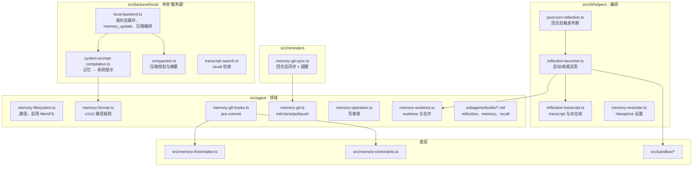

# 第 2 章 letta-code 记忆子系统地图

> 本章目标：在动手之前建立一张地图——记忆相关代码在哪些目录、Cloud 与 Local 两种后端怎么分工、磁盘上到底有哪些文件。前置：第 1 章。对应代码：mini-letta `v0.1`（地图本身不写代码）。

## 2.1 先看磁盘：一个 agent 的记忆长什么样

最快理解一个系统的办法，是看它在磁盘上留下了什么。用 letta-code 的本地后端创建一个 agent 后，相关目录大致是：

```text
$LETTA_LOCAL_BACKEND_DIR（默认 ~/.letta/lc-local-backend）
└── memfs/
    └── <agent-id>/
        ├── memory/                ← MemFS：一个普通的 git 仓库
        │   ├── .git/              ← hooks/pre-commit、锁文件、worktree 元数据
        │   ├── MEMORY.md          ← 根索引（无 frontmatter）
        │   ├── persona.md         ← core memory（name + description frontmatter）
        │   ├── human.md
        │   ├── projects/MEMORY.md ← 子目录索引：有它，这个目录才算记忆
        │   ├── projects/foo.md    ← deferred memory
        │   └── skills/<name>/SKILL.md
        └── memory-worktrees/      ← 反思/记忆 worker 的临时 worktree
~/.letta/transcripts/<agent-id>/<conversation-id>/
    ├── transcript.jsonl           ← 给反思用的对话增量
    └── state.json                 ← 反思水位线
```

几个路径的出处：

- 本地后端的存储根：`src/utils/local-backend-paths.ts:19`，默认 `~/.letta/lc-local-backend`；
- 记忆仓库：`src/backend/local/paths.ts:48` `getLocalBackendMemoryFilesystemRoot()` → `<storage>/memfs/<agent>/memory`；
- Cloud 后端在本机的检出位置：`src/agent/memory-filesystem.ts:46` `getMemoryFilesystemRoot()` → `~/.letta/agents/<agent>/memory`；
- worktree 目录：`src/agent/memory-worktree.ts:130`，是记忆仓库的**兄弟目录** `memory-worktrees`；
- 反思 transcript：`src/cli/helpers/reflection-transcript.ts:911` `getReflectionTranscriptPaths()`。

mini-letta 把这些压平到一个目录下，方便观察：

```text
$MINI_LETTA_HOME/agents/<agent-id>/
├── agent.json                      ← agent 记录（系统提示原文、反思设置）
├── memory/                         ← MemFS git 仓库（v0.2 起）
├── memory-worktrees/               ← 反思 worktree（v0.5）
├── reflections/payloads/           ← 反思 payload（v0.5）
├── reflection.lock                 ← 每个 agent 同时只允许一个反思（v0.5）
└── conversations/<conversation-id>/
    ├── messages.jsonl              ← 全部消息，只追加（recall）
    ├── context.json                ← 当前上下文窗口里的消息 id（v0.4）
    ├── system-prompt.json          ← 本对话编译好的系统提示缓存（v0.3）
    ├── pending-reminders.json      ← 下一回合要带上的 <system-reminder>（v0.3）
    ├── compaction-event.json       ← “刚压缩过”标记，触发反思（v0.4/v0.5）
    └── reflection-state.json       ← 反思水位线（v0.5）
```

## 2.2 两种后端：记忆的“主场”在哪里

letta-code 把“agent 存在哪里”抽象成 `Backend` 接口，并用 **capabilities** 描述每种后端能做什么（`src/backend/backend.ts:169`）：

```ts
// src/backend/backend.ts:169 起（节选）
export interface BackendCapabilities {
  remoteMemfs: boolean;      // 记忆仓库托管在服务器，本机是一个 clone
  promptRecompile: boolean;  // 能否重编译系统提示
  localMemfs: boolean;       // 记忆仓库就在本机，没有服务器
  // ...
}
```

两个实现：

| | `APIBackend`（Cloud，`backend.ts:376`） | `LocalBackend`（`local/local-backend.ts:178`） |
|---|---|---|
| agent 状态 | Letta 服务器 | 本机 JSON / JSONL |
| 记忆仓库 | 服务器托管，本机 `git clone` 到 `~/.letta/agents/<id>/memory` | 本机 `git init` 在 `<storage>/memfs/<id>/memory` |
| 系统提示编译 | 服务器做 | **本机做**（`system-prompt-compilation.ts`） |
| 压缩 | 服务器做 | 本机做（`local/compaction.ts`） |
| 回合后 | push 到服务器 | 没有远端可推 |
| capabilities | `remoteMemfs: true` | `localMemfs: true`、`promptRecompile: true` |

运行时用 `isActiveMemfsEnabled()` 判断当前 agent 是否走 MemFS（`src/agent/memory-runtime.ts:13`）：本地后端总是开启；Cloud 看 agent 上有没有 `git-memory-enabled` 标签（`src/agent/agent-tags.ts:18`）。

**本书主要读 LocalBackend**：它把服务器端那一半（编译、压缩、检索）也放到了 `src/backend/local/` 里，从用户输入到模型请求再到记忆落盘，是一条完整可读的链路。mini-letta 也是“本地后端”的形态，到第 18 章才加上一个“远端”。

## 2.3 MemFS 的两代布局

MemFS 有两代布局，由**根目录下有没有 `MEMORY.md`** 区分（`src/agent/memory-format.ts:6`）：

```ts
// src/agent/memory-format.ts:6-11
export function detectMemoryFormat(memoryDir: string, _localMemfs: boolean): LocalMemoryFormat {
  return existsSync(join(memoryDir, "MEMORY.md")) ? "memfs-v2" : "memfs-v1";
}
```

| | v1（legacy） | v2（root layout） |
|---|---|---|
| core memory 在哪 | `system/` 目录下的 `.md` | **仓库根目录**的 `.md` |
| 外部记忆 | 其余所有 `.md` | 只有带 `MEMORY.md` 索引的子目录 |
| frontmatter | `description`（可有 `read_only`、`limit`） | **恰好** `name` + `description` |
| 编译出的样子 | `<self>`、`<memory>` 树形 + `<memory_metadata>` | 每个根文件一个 `<label>` 段 + `<memory>`（含 `<deferred-memory>`） |

新建的本地 agent 一律是 v2（`src/backend/local/initial-memory.ts:79` 的注释：“Local agents are always born on the MemFS v2 root layout”）。本书和 mini-letta 只实现 v2，v1 在需要对比时提及。

## 2.4 代码地图

把记忆相关的文件按“它解决什么问题”归类：



几个值得记住的事实：

- **记忆的“规则”放在最底层**：frontmatter 校验（`src/memory-frontmatter.ts`）和预算约束（`src/memory-constraints.ts`）在 `src/` 根下，不依赖任何领域代码——因为它们的源码要被**原样嵌入 git hook**（第 7 章）。
- **编译在 backend 层**：系统提示怎么拼，是“服务器”的职责。Cloud 上它在服务器里；本地后端把它实现在 `src/backend/local/`。
- **反思在 cli 层编排**：它需要知道“回合结束了”“刚刚压缩过”这样的界面级事件。

## 2.5 一个容易忽略的事实：三条编排路径

letta-code 的 CLAUDE.md 反复强调：交互式 TUI、headless、websocket 监听器有**各自的**回合编排代码。以“回合结束后同步记忆”为例，`runPostTurnMemorySync()`（`src/reminders/memory-git-sync.ts:162`）在三处被调用：

```text
src/headless.ts:3097, 4742                 ← headless
src/cli/app/use-submit-handler.ts:3746      ← 交互式 TUI
src/websocket/listener/turn-cleanup.ts:51   ← 桌面端 / 远程
```

`maybeLaunchPostTurnReflection()` 同理（`src/headless.ts:4664`、`src/cli/app/AppCoordinator.tsx:3606`、`src/websocket/listener/turn-completion.ts:92`）。改记忆行为时三处都要看——这是 letta-code 代码审查里反复出现的检查项。mini-letta 只有一个 CLI，所以只有一处。

## 2.6 练习

1. **巩固**：画出 mini-letta v1.0 的 `$MINI_LETTA_HOME` 目录树，并对每个文件标注“它在第几章出现、谁写它、谁读它”。
2. **扩展**：如果要让 mini-letta 也支持 v1 布局（`system/` 目录），`isCoreMemoryPath` 要怎么改？（对照 `src/agent/memory-format.ts:13-21`。）
3. **读源码**：`resolveScopedMemoryDir()`（`src/agent/memory-filesystem.ts:100`）定义了四级优先级来决定“当前的记忆目录是哪个”。为什么运行时上下文要优先于 `MEMORY_DIR` 环境变量？（提示：想想子 agent 进程继承父进程环境变量的情况。）

## 2.7 延伸阅读

- letta-code `CLAUDE.md` 的 “Layer boundaries” 与 “Filesystem Sandbox” 两节。
- `src/backend/local/paths.ts`：本地后端的路径原语，以及“只给无状态子 agent 用的 memfs 关闭开关”。
