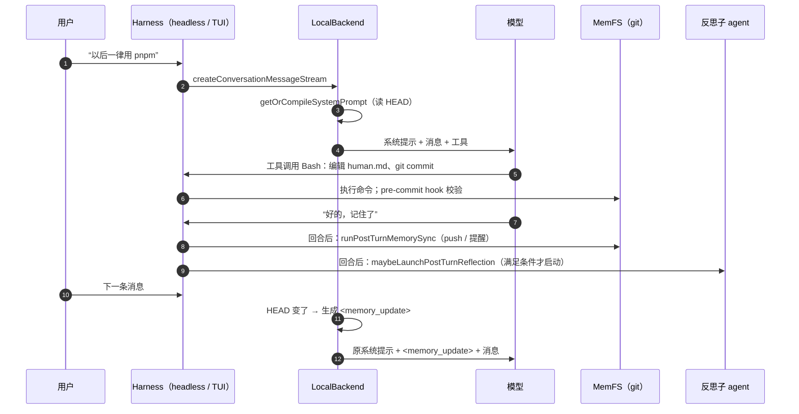

# 第 3 章 ★ 一条记忆的一生

> 本章目标：沿着一条真实的调用链，看一句“以后用 pnpm”是怎样变成 agent 未来每一次调用都会看到的系统提示的。这一章是全书的脊梁，后面每个 Part 都是在放大这条链上的某一段。前置：第 2 章。对应代码：mini-letta `v1.0`（本章只读不写，Lab 1 开始动手）。

## 3.1 场景

你在 letta-code 里对 agent 说：

> 以后这个项目一律用 pnpm，别再用 npm 了。

我们要追踪的问题是：**这句话在什么时候、以什么形式、经过哪些检查，最终影响到 agent 后来的行为？**

答案分成六站：



下面一站一站看。

## 3.2 第一站：回合开始，编译系统提示

用户消息进入后端后，`HeadlessBackend.executeConversationTurn()`（`src/backend/dev/fake-headless-backend.ts:469`）取出历史消息，然后调用 `resolveSystemPromptForTurn()`（同文件 `:526`）。本地后端覆写了这个方法（`src/backend/local/local-backend.ts:462`），核心是：

```ts
// src/backend/local/local-backend.ts:483-497（节选）
const persisted = await this.getOrCompileSystemPrompt(
  input.conversationId, input.agentId, input.agent, input.history.length,
);
return {
  systemPrompt: appendAvailableSkillsBlock(persisted.content, clientSkills),
  ...(persisted.midConversationSystemPrompt
    ? { midConversationSystemPrompt: persisted.midConversationSystemPrompt }
    : {}),
};
```

`getOrCompileSystemPrompt()`（`local-backend.ts:896`）是一个**按对话缓存**的编译器：它记住这个对话上次编译时的两个指纹——原始系统提示的哈希 `rawSystemHash`，以及记忆仓库的提交号 `memfsRevision`。第一次进入一个对话时没有缓存，于是完整编译一次：`compileLocalSystemPrompt()`（`src/backend/local/system-prompt-compilation.ts:432`）。

编译做的事情可以一句话说完：**用 `git ls-tree HEAD` 列出已提交的记忆文件，用 `git show HEAD:<path>` 读出内容，渲染成 XML 风格的段落，替换系统提示里的 `{CORE_MEMORY}`。** 关键在“HEAD”——工作区里没提交的改动，编译器看不见（第 6、8 章）。

## 3.3 第二站：模型决定改记忆

系统提示里有一整节在教模型怎么改记忆（第 10 章细读）。v2 的 Cloud 提示词说得很具体：

```markdown
<!-- src/agent/prompts/letta_root_memfs.md:62 节选 -->
... stage only the files you changed by explicit path (never `git add -A` or
`git add .`) and commit them in the same shell call.
```

所以一个守规矩的模型会发出类似这样的 Bash 工具调用：

```bash
cd "$MEMORY_DIR"
git status && git diff
# 编辑 human.md，加一行 "- 这个项目一律用 pnpm（2026-10-09）"
git add human.md
git commit --author="$AGENT_NAME <$AGENT_ID@letta.com>" -m "fix: use pnpm, never npm" -- human.md
```

注意：letta-code **没有**专门的“写记忆”工具。记忆就是文件，agent 用和改代码一样的 Bash/Edit 工具改它。这是 MemFS 设计最大的胆量——也是后面所有防护措施存在的原因。

## 3.4 第三站：git hook 把关

`git commit` 触发记忆仓库里的 `pre-commit` hook。这个 hook 是 harness 在初始化/克隆/拉取时安装的（`src/agent/memory-git-hooks.ts:294` `installMemoryGitHooks()`），内容由 `buildPreCommitHookScript()`（`:38`）生成。它会：

- 校验每个记忆文件的 frontmatter（根 `MEMORY.md` 不能有；其他文件必须恰好有 `name` 和 `description`）；
- 按 `.memfs.config.json`（没有就用默认值）检查单文件字符数、核心记忆总字符数、目录深度、只读文件；
- 不通过就 `exit 1`，提交失败，模型在工具结果里看到失败原因。

hook 的妙处在于它不依赖模型守规矩：**不管模型用什么方式写文件，只要想让改动生效，就必须提交；只要提交，就必须过 hook。**（第 7 章）

## 3.5 第四站：回合结束后的两件事

模型回复“好的，记住了”，回合结束。harness 在回合后做两件事（第 2 章提到，它们在三条编排路径里各被调用一次）：

**(1) 同步记忆**——`runPostTurnMemorySync()`（`src/reminders/memory-git-sync.ts:162`）调用 `syncPendingMemoryCommitsAfterTurn()`（`src/agent/memory-git.ts:1837`），依次检查：

```text
没有 .git            → skipped
有未解决的合并冲突    → conflict
有未提交的改动        → dirty      ← 模型改了文件但忘了提交
后端不支持远端        → skipped    ← 本地后端到这里就结束
没有领先的提交        → clean
否则 push；非快进则 pull --rebase 再 push
```

`dirty`、`conflict` 等状态会被格式化成一条 `<system-reminder>`，排进下一回合（`formatMemoryPostTurnSyncReminder()`，`memory-git-sync.ts:58`）。比如 dirty 时：

```text
MEMORY COMMIT NEEDED: The memory repository has uncommitted changes.
...
Commit these memory changes when appropriate, staging only the files you changed.
```

**(2) 判断要不要反思**——`maybeLaunchPostTurnReflection()`（`src/cli/helpers/post-turn-reflection.ts:22`）。默认触发器是 `compaction-event`（`src/cli/helpers/memory-reminder.ts:51`）：只有这一回合里发生过上下文压缩，才启动反思子 agent；另一种是 `step-count`，累计 25 步（`memory-reminder.ts:15`）启动一次。反思在后台、在一个独立的 git worktree 里进行，完成后由 harness 合并回主仓库（第 14–17 章）。

## 3.6 第五站：下一回合，`<memory_update>`

用户发来下一条消息。`getOrCompileSystemPrompt()` 发现：原始系统提示没变，但 `memfsRevision`（HEAD）变了。这时它**不会**直接用新编译的系统提示替换旧的，而是：

```ts
// src/backend/local/local-backend.ts:917-939（节选）
if (existing?.rawSystemHash === rawSystemHash && existing.memfsRevision !== memfsRevision) {
  const compiled = await this.compileAndMaybePersistSystemPrompt(conversationId, agentId, { dryRun: true, ... });
  if (compiled.memfsRevision !== existing.memfsRevision) {
    const midConversationSystemPrompt = formatMidConversationMemoryUpdate(compiled);
    this.store.setCompiledSystemPrompt(conversationId, agentId, {
      ...existing,                       // ← 旧的系统提示原样保留
      compiledAt: compiled.compiledAt,
      coreMemory: compiled.coreMemory,
      memfsRevision: compiled.memfsRevision,
    });
    return { ...existing, midConversationSystemPrompt };
  }
}
```

为什么保留旧的？因为**提示缓存**（prompt caching）：服务商按前缀缓存，系统提示一个字节都不变，前面的缓存就全部命中；一旦改动系统提示，整段上下文都要重新计费。所以 letta-code 选择把新记忆作为一段**追加在末尾**的 `<memory_update>` 发给模型（`formatMidConversationMemoryUpdate()`，`local-backend.ts:165`）：

```text
<memory_update>
The local memory filesystem has been edited and committed at revision <sha>.
This updates part of your persona/system memory. Treat the following freshly rendered
memory context as authoritative from now on; where it conflicts with earlier memory
context, this newer memory context wins.
...新编译出的 core memory...
</memory_update>
```

它被放进 provider 请求的消息列表末尾（`src/backend/dev/pi-stream-adapter.ts:595`）。

## 3.7 第六站：新对话，记忆进入系统提示

几天后你开了一个新对话。没有缓存，完整编译——这次 `human.md` 里的那行“一律用 pnpm”直接出现在系统提示里。从此以后，每一个新对话都“天生”知道这件事。

另外两种情况也会触发完整重编译：原始系统提示变了（换了预设），以及**压缩之后**（`local-backend.ts:760` 与 `:784`，压缩完调用 `compileAndMaybePersistSystemPrompt(..., { dryRun: false })`）。压缩本来就要重写上下文，缓存反正失效，顺便把记忆折叠进系统提示。

## 3.8 我们用探针验证了什么，又发现了什么

为了确认第五站的行为，我们在 `70ead335` 的一个本地克隆里写了一个一次性测试：用 `LocalBackend` 加一个假的执行器（只记录收到的 `systemPrompt` 和 `midConversationSystemPrompt`），先跑一回合，然后在记忆仓库里提交 `persona.md`（内容含 `NEW-FACT`），再跑两回合。真实输出：

```text
turn1: systemHasFact=false midHasFact=false uiMessages=1
turn2: systemHasFact=false midHasFact=true uiMessages=3
turn3: systemHasFact=false midHasFact=false uiMessages=5
uiMessages: [["user",false],["assistant",false],["user",false],["assistant",false],["user",false]]
```

第二回合，`<memory_update>` 如期出现，系统提示保持不变——和上面读到的代码一致。

**但第三回合，两处都没有这条新记忆。** 记录在缓存里的 `memfsRevision` 已经更新成新的 HEAD，所以第三回合被判定为“没有变化”；而 `<memory_update>` 只被推进了第二回合那一次 provider 请求的消息列表，**没有写进对话历史**（第三回合的 `uiMessages` 里没有它）。也就是说，在这个提交上的本地后端里，对话中途提交的记忆变化**只对模型可见一次**，之后要等到新对话或压缩触发完整重编译，才会再次出现。

这是不是 bug？`<memory_update>` 的文案写着“从现在起以此为准（authoritative from now on）”，而系统提示也告诉模型“Editing memory does NOT change your behavior in the current turn”（`letta_root_memfs.md:56`）——两种理解都说得通。我们只陈述观察到的行为。mini-letta 选择了另一种做法：把 `<memory_update>` 作为一条**持久化的 user 角色 `<system-reminder>` 消息**写进对话历史，这样它在后续每一回合都还在，直到压缩把它连同旧消息一起摘要掉、并触发完整重编译（第 9 章）。这样做也符合 letta-code 自己 CLAUDE.md 里的规则：“Automated notifications use user-role reminders”。

## 3.9 把这条链映射到 mini-letta

| 站 | letta-code | mini-letta v1.0 |
|---|---|---|
| 编译 | `compileLocalSystemPrompt` | `src/memory/compile.ts` `compileSystemPrompt` |
| 按对话缓存 | `getOrCompileSystemPrompt` | `src/agent/system-prompt.ts` `resolveSystemPrompt` |
| 改记忆 | Bash/Edit + git | `bash`/`edit_file` 工具 + git |
| 把关 | `buildPreCommitHookScript` | `src/memory/hooks.ts`（同样嵌入校验函数源码） |
| 回合后同步 | `syncPendingMemoryCommitsAfterTurn` | `checkMemoryAfterTurn` + `src/sync/remote.ts` `syncAfterTurn` |
| 回合后反思 | `maybeLaunchPostTurnReflection` | `src/reflection/post-turn.ts` |
| 中途更新 | `<memory_update>`，单次请求 | `<memory_update>`，持久化的 user 提醒 |

在 mini-letta 里跑一遍同样的故事（mock 模型，离线）：

```text
$ export MINI_LETTA_HOME=$(mktemp -d)
$ bun src/cli.ts chat -p "你好"
（mock）我听到了：你好
$ bun src/cli.ts chat -p "设定：回答末尾总是加上 🦉"
  ⚙ bash({"command":"cd \"$MEMORY_DIR\" && printf '%s\\n' '- 回答末尾总是加上 🦉' >> persona.md && git add persona.md && git commit -q -m 'feat: update persona' -- persona.md && git log --oneline -1"})
  ✓ ab85f70 feat: update persona

  ↻ memory changed — injected <memory_update> reminder
好的，我已经把这件事记进记忆里了。 🦉
$ bun src/cli.ts chat -p "你好"
（mock）我听到了：你好 🦉
$ bun src/cli.ts chat -p "再说一次"
（mock）我听到了：再说一次 🦉
$ bun src/cli.ts prompt | grep -c "🦉"
[cached · compiled 2026-10-08T15:55:21.450Z · memfs ab85f70]
0
$ bun src/cli.ts prompt --fresh | grep "🦉"
[fresh · compiled 2026-10-08T15:55:21.550Z · memfs ab85f70]
- 回答末尾总是加上 🦉
```

读这段输出要注意三件事：

1. 提交之后**同一回合的下一步**就注入了 `<memory_update>`（工具调用之后、最终回复之前），所以连“好的”那句都带上了 🦉；
2. 之后的每一回合都还记得（因为提醒是持久化的）；
3. 这个对话**缓存的**系统提示里一个 🦉 都没有（`grep -c` 为 0）——系统提示保持字节级不变；而 `--fresh` 编译出的新提示里有。新对话会用新的。

## 3.10 练习

1. **巩固**：在 mini-letta 里重复 3.9 的步骤，然后 `cat $MINI_LETTA_HOME/agents/agent-default/conversations/default/system-prompt.json`，解释为什么 `memfsRevision` 已经是新的提交，`content` 却还是旧的。
2. **扩展**：如果用户在一个对话里连续改了三次记忆，mini-letta 的对话历史里会有三条 `<memory_update>`。它们的内容有大量重复，怎样在不破坏提示缓存的前提下减少重复？（提示：只能往后追加，不能改前面的消息。）
3. **读源码**：在 letta-code 里找到 `compactLocalConversationInner()`（`src/backend/local/local-backend.ts:727`），确认压缩后它调用了 `compileAndMaybePersistSystemPrompt(..., { dryRun: false })`。为什么在这个时机重编译系统提示是“免费”的？

## 3.11 延伸阅读

- Anthropic / OpenAI 的 prompt caching 文档：缓存按前缀匹配。
- letta-code `src/backend/local-backend.test.ts` 里的 `"sends committed memory changes through a transcript update"`——它验证的正是第二回合的行为。
