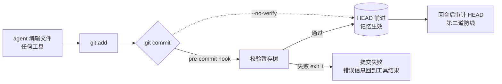

# 第 7 章 守门员：pre-commit hook、frontmatter 与预算

> 本章目标：理解 letta-code 怎么在“agent 可以随便写文件”的前提下保持记忆仓库的形状和大小可控——一个嵌入了校验函数源码的 pre-commit hook、一份受保护的预算配置，以及 hook 被绕过时的第二道防线。前置：第 4–6 章。对应代码：mini-letta `v0.2` `src/memory/{frontmatter,constraints,hooks}.ts`，`v1.0` `src/memory/audit.ts`。

## 7.1 问题：文件可以被写成任何样子

第 6 章的踩坑记录里，一个 3B 模型用 `write_file` 把 `human.md` 整个覆盖成了一团乱码。它这次没提交，所以没出事。但下一次呢？

记忆仓库需要一个**不依赖模型守规矩**的守门员。git 的 pre-commit hook 正好处在“改动生效”的唯一入口上：



## 7.2 规则一：frontmatter

规则的唯一实现是 `validateMemoryFileFrontmatter()`（`src/memory-frontmatter.ts:18`）。v2 的规则：

| 文件 | 规则 |
|---|---|
| 任何目录下的 `MEMORY.md` | **不能**有 frontmatter |
| 其他记忆 `.md` | 必须以 `---` 开头并闭合；只允许 `name`、`description` 两个键；都不能为空；不能重复 |

legacy（v1）的规则不同：只要求 `description`；允许 `read_only` 和遗留的 `limit`；而 `read_only` 是**受保护字段**——agent 不能添加、删除或修改它，HEAD 里标记了 `read_only: true` 的文件不能改。值得注意的是，判断 `read_only` 用的是 `previousContent`，函数签名的注释特意写明：

```ts
// src/memory-frontmatter.ts:1-7
export interface MemoryFileFrontmatterInput {
  path: string;
  content: string;
  /** Accepted contents of this path, never contents supplied by the change. */
  previousContent: string | null;
  format: "memfs-v2" | "legacy";
}
```

“已接受的内容，绝不是这次改动提供的内容”——授权决定只能基于可信的旧状态，不能让被校验的对象自己证明自己。这句注释是整个守门员设计的缩影。

## 7.3 关键技巧：把校验函数的源码嵌进 hook

hook 在 `git commit` 时由 git 调用，运行在记忆仓库里。那里**没有** letta-code 的 `node_modules`，也不能假设机器上装了 `node`（桌面版只带一个 Electron 可执行文件）。letta-code 的做法是：在生成 hook 脚本时，把校验函数的**源码文本**直接拼进去：

```ts
// src/agent/memory-git-hooks.ts:88-91（生成的 hook 中的一段 here-doc）
result=$(run_memory_node - "$1" "$memory_layout_policy" "${memory_files[@]}" <<'LETTA_MEMORY_FRONTMATTER'
const { execFileSync, spawnSync } = require("node:child_process");
const validateMemoryFileFrontmatter = ${validateMemoryFileFrontmatter.toString()};
```

`run_memory_node` 用的是 **CLI 自己的可执行文件路径** `process.execPath`（Electron 下加 `ELECTRON_RUN_AS_NODE=1`；Windows 上还把 `C:\...` 改写成 Git Bash 认识的 `/c/...`，见 `memory-git-hooks.ts:38-58`）。所以：

- 校验逻辑只有**一份**源码，CLI 和 hook 用的是同一个函数；
- 为了能被 `toString()` 嵌入，这个函数必须**自包含**：不能引用模块里的其他东西。`src/memory-frontmatter.ts` 的注释写着：“This is deliberately self-contained: the Git hook embeds its source so it does not depend on a package installation in the memory repository.”
- 这也是它为什么放在 `src/` 根下最底层（第 2 章）。

树约束检查是同样的套路，只是脚本更大，被写成一个独立文件 `memory-constraints-validator` 放进 `.git/hooks/`（`src/agent/memory-constraints.ts` 生成 `MEMORY_CONSTRAINTS_VALIDATOR_SCRIPT`）。

## 7.4 v2：校验整棵暂存树

legacy 模式只校验“这次新增或修改的”`system/`、`reference/` 下的文件。v2 模式校验的是**整棵暂存树**：

```js
// src/agent/memory-git-hooks.ts:93-98（hook 内嵌 JS）
// MemFS v2 validates the complete staged tree, not just changed files. Read
// paths from Git inside the child instead of passing them through argv: Git
// Bash on Windows cannot launch Node with a sufficiently large path list.
const paths = format === "memfs-v2"
  ? execFileSync("git", ["ls-files", "-z", "*.md"], ...).split("\0").filter(Boolean)
  : stagedPaths;
```

注释里还藏着一个跨平台的坑：Windows 上 Git Bash 启动 Node 时命令行长度有限，所以路径列表不通过 argv 传，而是在子进程里自己去问 git。

整树校验的好处是“仓库永远处在合法状态”；副作用我们在第 5 章亲眼见过：一个留在暂存区的坏文件，会挡住之后所有的提交。

## 7.5 规则二：预算与形状（`.memfs.config.json`）

```ts
// src/memory-constraints.ts:302-308
export const DEFAULT_MEMORY_CONSTRAINTS_CONFIG: Readonly<MemoryConstraintsConfig> =
  Object.freeze({
    version: MEMORY_CONSTRAINTS_CONFIG_VERSION,
    maxDepth: 2,
    maxFileCharacters: 20_000,
    maxCoreMemoryCharacters: 65_536,
  });
```

| 配置项 | 含义 |
|---|---|
| `maxDepth` | 记忆文件最深几层（`a/b/c.md` 深度 2） |
| `maxFileCharacters` | 单文件字符上限（按 Unicode 码点数，不是字节） |
| `maxCoreMemoryCharacters` | **根目录所有 `.md` 加起来**的上限——也就是系统提示里记忆部分的预算 |
| `fileCharacterLimits` | 按 glob 覆盖单文件上限 |
| `readOnlyFiles` | 这些 glob 匹配的文件不能被创建、修改或删除 |

`validateMemoryTreeConstraints()`（`src/memory-constraints.ts:39`）还顺带检查第 5 章的“索引链”。

### 谁来保护规则本身？

如果 agent 能改 `.memfs.config.json`，它就能把预算改成无穷大。所以配置文件本身是受保护的：

```js
// src/agent/memory-constraints.ts:132-146（validator 脚本内）
const configChanged = !gitSucceeds(["diff", "--cached", "--quiet", "--", CONFIG_PATH]);
...
if (configChanged && process.env[CONFIG_UPDATE_ENV] !== "1") {
  errors.push(CONFIG_PATH + " is protected and requires human approval to change");
}
```

`CONFIG_UPDATE_ENV` 是 `LETTA_MEMORY_CONSTRAINTS_UPDATE`（`src/agent/memory-constraints.ts:32`）。agent 的 shell 里没有这个变量；人类要放宽限制时，自己在命令前加上它。报错文案也是写给 agent 看的：

```text
Limits come from .memfs.config.json, or the Letta Code defaults when it is absent.
Do not raise or disable these limits unless the user explicitly approves it.
```

## 7.6 第二道防线：审计已提交的树

hook 可以被绕过：`git commit --no-verify`；或者某个没装 hook 的克隆。letta-code 在**推送前**再校验一次：`syncPendingMemoryCommitsAfterTurn()` 调用 `invalidPendingMemory()`（`src/agent/memory-git.ts:1905`），后者用 `validateMemoryConstraintsHead()`（`src/agent/memory-constraints-audit.ts:52`）——**用一个临时的 `GIT_INDEX_FILE` 把 HEAD 读进去，再跑同一个 validator**，不碰真实的暂存区。校验不过的状态叫 `invalid`，交给后台的修复 worker（第 17 章）。

注意它挂在“推送”这条路上：对 Cloud 来说，没有通过校验的记忆不会离开本机。

## 7.7 mini-letta 的实现

三个自包含函数：`validateMemoryFile`（`src/memory/frontmatter.ts`）、`isProjectedMemoryPath`（`src/memory/format.ts`）、`validateMemoryTree` + `globToRegExp`（`src/memory/constraints.ts`）。hook 由两部分组成——一行 bash，和一个嵌入了上述函数源码的 JS 文件：

```ts
// code/mini-letta @ v0.2  src/memory/hooks.ts（节选）
export function buildValidatorScript(): string {
  return `// Installed by mini-letta. Validates the staged memory tree.
const { execFileSync } = require("node:child_process");
const validateMemoryFile = ${validateMemoryFile.toString()};
const isProjectedMemoryPath = ${isProjectedMemoryPath.toString()};
const globToRegExp = ${globToRegExp.toString()};
const validateMemoryTree = ${validateMemoryTree.toString()};
const DEFAULT_CONFIG = ${JSON.stringify(DEFAULT_MEMORY_CONSTRAINTS)};
...`;
}

export function buildPreCommitHook(runtimePath = process.execPath): string {
  return `#!/usr/bin/env bash
# Installed by mini-letta
exec '${runtimePath.replaceAll("'", `'"'"'`)}' "$(git rev-parse --git-common-dir)/hooks/${VALIDATOR_NAME}"
`;
}
```

一个 Bun 特有的细节：Bun 的 `Function.prototype.toString()` 返回的是**转译后的 JS**（类型标注已去掉），所以 TypeScript 源码也能直接嵌进 hook。装好的 hook 文件开头是这样的（真实内容）：

```js
// Installed by mini-letta. Validates the staged memory tree.
const { execFileSync } = require("node:child_process");
const validateMemoryFile = function validateMemoryFile(path, content) {
  const lines = content.split(`
`);
  if (path.split("/").at(-1) === "MEMORY.md")
    return lines[0] === "---" ? [`${path}: MEMORY.md must not have frontmatter`] : [];
  ...
```

hook 路径用 `git rev-parse --git-common-dir`，这样在 worktree 里（第 16 章）提交时也能找到同一份 hook。配置的保护和 letta-code 一样：配置只从 HEAD 读取；暂存区里的配置和 HEAD 不同、又没有 `MINI_LETTA_CONSTRAINTS_UPDATE=1`，就拒绝。

v1.0 补上了第二道防线 `auditCommittedMemory()`（`src/memory/audit.ts`），见 7.9。

## 7.8 运行与验证

```text
$ D=$(bun src/cli.ts memory path) && cd $D
$ printf 'oops\n' > notes.md && git add notes.md && git commit -m "add notes"
Memory validation failed:
  notes.md: missing frontmatter (must start with ---)
```

预算配置（`test/v02-memfs.test.ts` 的 “the policy file itself is protected”）：

```ts
const denied = commit(dir, ".memfs.config.json", '{"version":1,"maxFileCharacters":120}\n');
expect(denied.stderr).toContain(".memfs.config.json is protected and requires human approval to change");
const approved = git(dir, ["commit", "-q", "-m", "policy"], { MINI_LETTA_CONSTRAINTS_UPDATE: "1" });
expect(approved.ok).toBe(true);
const tooBig = commit(dir, "big.md", `---\nname: Big\ndescription: too big\n---\n${"x".repeat(100)}\n`);
expect(tooBig.stderr).toContain("big.md: 140 characters exceeds 120 from maxFileCharacters");
```

### 踩坑记录 1：收紧预算的提交本身被拒了

这个测试一开始把上限设成了 `10`，带着 `MINI_LETTA_CONSTRAINTS_UPDATE=1` 提交配置——**依然失败**。原因：校验的是整棵树，而已经存在的 `persona.md`、`human.md` 远远超过 10 个字符。也就是说，**你不能用一次提交把预算收紧到现有记忆已经违反的程度**，必须先把记忆瘦身，再收紧预算。这和 letta-code 报错里那句 “Validation checks the complete repository, so these problems may predate your staged changes”（`src/agent/memory-constraints.ts:101`）说的是同一件事。我们把测试改成了合理的 120。

### 踩坑记录 2：`--no-verify` 直通系统提示

写这一章时我们试了一下绕过 hook（v1.0 之前的 mini-letta）：

```text
$ printf 'BYPASSED: no frontmatter\n' > $D/human.md
$ git -C $D commit -qam "sneaky"
Memory validation failed:
  human.md: missing frontmatter (must start with ---)
normal exit=1
$ git -C $D commit -q --no-verify -am "sneaky"
no-verify exit=0
$ bun src/cli.ts prompt --fresh | grep -n "BYPASSED\|<human>"
11:<human>
12:BYPASSED: no frontmatter
```

坏文件直接进了系统提示。mini-letta 没有远端推送这一关，所以 letta-code 的第二道防线在这里没有对应物。

## 7.9 修复：回合后审计 HEAD

我们把 letta-code `validateMemoryConstraintsHead()` 的思路搬了过来，但挂在**回合结束**而不是推送前（因为 mini-letta 的本地 agent 未必有远端）：

```ts
// code/mini-letta @ v1.0  src/memory/audit.ts（节选）
export function auditCommittedMemory(memoryDir: string): string[] {
  if (!git(memoryDir, ["rev-parse", "--verify", "HEAD"]).ok) return [];
  const temp = mkdtempSync(join(tmpdir(), "mini-letta-audit-"));
  const env = { ...process.env, GIT_INDEX_FILE: join(temp, "index") };
  try {
    spawnSync("git", ["read-tree", "HEAD"], { cwd: memoryDir, env });     // 临时 index = HEAD
    const validator = join(temp, "validate.js");
    writeFileSync(validator, buildValidatorScript());                      // 同一个 validator
    const result = spawnSync(process.execPath, [validator], { cwd: memoryDir, env, encoding: "utf8" });
    ...
  } finally { rmSync(temp, { recursive: true, force: true }); }
}
```

第一版只在“HEAD 在本回合里动过”时审计。写 Lab 3 时我们发现这不够：**两个回合之间**用 `--no-verify` 提交（人手改的、别的进程改的）根本不会被审计。最终版本改成“每个新的 HEAD 只审计一次，不管是谁、什么时候挪动了它”，并在回合**开始**和**结束**各检查一次：

```ts
// code/mini-letta @ v1.0  src/memory/audit.ts（节选）
export function auditIfHeadChanged(memoryDir: string): string[] {
  const revision = headRevision(memoryDir);
  if (!revision) return [];
  const record = join(gitDir(memoryDir), LAST_AUDIT);      // 记录上次审计过的 revision
  const last = existsSync(record) ? JSON.parse(readFileSync(record, "utf8")) : {};
  if (last.revision === revision) return [];
  const problems = auditCommittedMemory(memoryDir);
  writeFileSync(record, JSON.stringify({ revision, ok: problems.length === 0 }));
  return problems;
}
```

这里还有第二个坑：记录文件一开始写在 `join(memoryDir, ".git", ...)`，结果**5 个跑反思的测试全部变成 `failed`**——反思子 agent 的 `memoryDir` 是一个 git worktree，worktree 里的 `.git` 是一个**文件**（内容是 `gitdir: <主仓库>/.git/worktrees/<name>`），不是目录。letta-code 为此专门有一个 `getMemoryGitDir()`（`src/agent/memory-git-dir.ts:11`），注释写着 “Worktrees have their own, so state kept here (locks, repair attempts, operation heads) stays independent”。我们照搬成 `gitDir()`（`git rev-parse --git-dir`）。

回归测试（`test/v02-memfs.test.ts`、`test/v03-compile.test.ts`）：

```ts
expect(git(dir, ["commit", "-q", "--no-verify", "-am", "sneaky"]).ok).toBe(true);
expect(auditCommittedMemory(dir)).toEqual(["human.md: missing frontmatter (must start with ---)"]);
// The audit used a throwaway index: the real one is untouched.
expect(git(dir, ["status", "--porcelain"]).stdout).toBe("");
```

```ts
// 回合之间的 --no-verify 提交，在下一回合开头就被报告，且同一个 revision 只报告一次
writeFileSync(join(memoryDir, "persona.md"), "BROKEN persona without frontmatter\n");
expect(git(memoryDir, ["commit", "-q", "--no-verify", "-am", "broken"]).ok).toBe(true);
await runTurn({ ..., userText: "在吗" });
expect(turn).toContain("MEMORY INVALID");
expect(turn).toContain("persona.md: missing frontmatter");
```

这仍然不能阻止坏记忆在**下一回合开始前**被编译进新对话——想做到那一步，编译器要么拒绝编译未通过审计的 HEAD，要么退回到最近一个通过审计的提交。这是练习 2。

## 7.10 练习

1. **巩固**：写一个 `.memfs.config.json`，用 `readOnlyFiles: ["persona.md"]` 保护人格文件（记得带上 `MINI_LETTA_CONSTRAINTS_UPDATE=1`）。然后让 mock 的“设定：”规则去改 `persona.md`，观察工具结果里的错误，以及 mock 模型如何回复。
2. **扩展**：让编译器只编译“最近一个通过审计的提交”：在 `.git/` 里记录 `last-valid-revision`，审计失败时编译那个版本，并在 `<memory_update>` 里说明原因。想一想：这样做和“只认 HEAD”的不变量冲突吗？
3. **读源码**：letta-code 的 hook 在 v2 模式下会拒绝扁平的 `skills/foo.md`（`memory-git-hooks.ts:149-151` 的循环）。为什么技能必须是目录？结合第 5 章和反思提示词里对 `scripts/`、`references/` 的描述回答。
