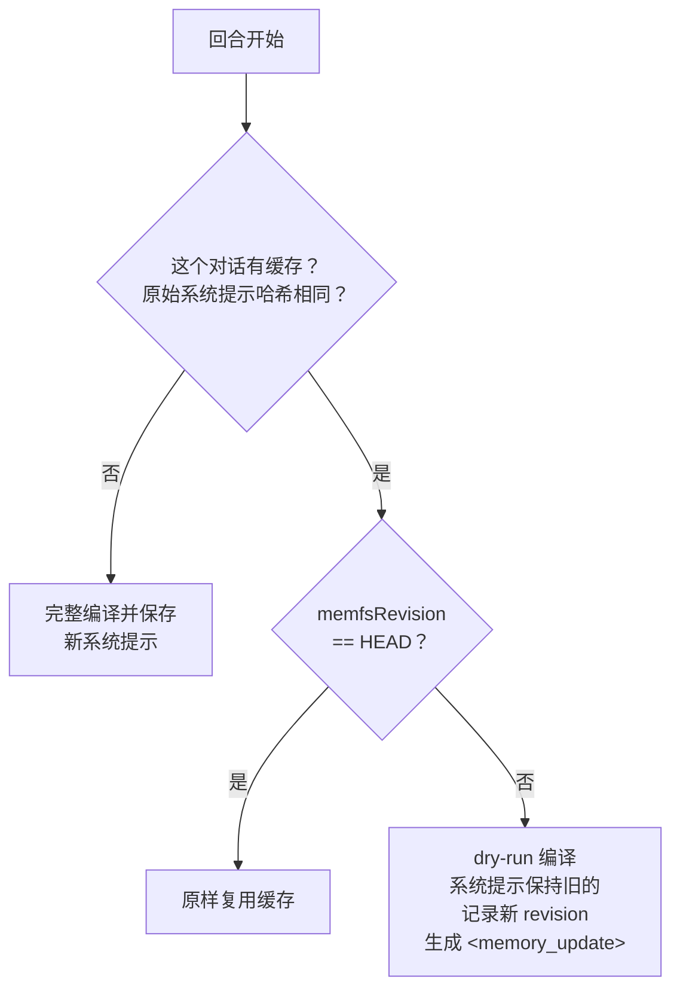

# 第 9 章 ★★ 何时重编译：缓存、`<memory_update>` 与提醒

> 本章目标：理解“记忆变了”和“系统提示变了”是两件事；读懂 letta-code 按对话缓存系统提示的三分支逻辑、`<memory_update>` 的生命周期，以及回合前后的各种 `<system-reminder>`。前置：第 3、8 章。对应代码：mini-letta `v0.3` `src/agent/{system-prompt,reminders,loop}.ts`。

## 9.1 两股相反的力

- **新鲜度**：记忆一提交，agent 最好马上就“知道”。
- **稳定性**：系统提示是请求的最前缀。服务商的提示缓存按前缀匹配，系统提示改一个字节，整段上下文的缓存全部失效，下一次请求按原价计费、而且更慢。letta-code 的 `/recompile` 命令描述里直接写着警告：“warning: this will evict the cache and increase costs”（`src/cli/commands/registry.ts:411-412`）。

v0.1/v0.2 的 mini-letta 每一步都重编译——最新鲜，也最贵。letta-code 的选择是：**系统提示在一个对话里尽量保持字节不变；记忆的变化以“追加在末尾”的方式告知模型。**

## 9.2 三分支缓存



对应 `LocalBackend.getOrCompileSystemPrompt()`（`src/backend/local/local-backend.ts:896`），第 3 章摘录过关键分支。几个要点：

- **缓存是按对话的**（`store.getCompiledSystemPrompt(conversationId, agentId)`）。同一个 agent 的两个对话可以拿着不同版本的系统提示。
- **原始系统提示变了**（比如用 `/system` 换了预设）就完整编译——这种变化本来就要求新提示。
- **记忆变了**：用 dry-run 编译一次，只为了拿到新的 `coreMemory`；保存时用 `...existing` 保留旧的 `content`，只更新 `coreMemory`、`memfsRevision`、`compiledAt`。

## 9.3 `<memory_update>` 怎么送到模型

```ts
// src/backend/local/local-backend.ts:165-176
function formatMidConversationMemoryUpdate(compiled: LocalCompiledSystemPrompt): string {
  return [
    "<memory_update>",
    `The local memory filesystem has been edited and committed at revision ${compiled.memfsRevision ?? "unknown"}.`,
    "This updates part of your persona/system memory. Treat the following freshly rendered memory context as authoritative from now on; where it conflicts with earlier memory context, this newer memory context wins.",
    "",
    compiled.coreMemory.trimEnd(),
    "</memory_update>",
  ].join("\n");
}
```

它作为 `midConversationSystemPrompt` 一路传到 provider 适配层，被追加到消息列表**末尾**、角色是 `system`：

```ts
// src/backend/dev/pi-stream-adapter.ts:594-601
const messages = toPiMessages(input.uiMessages);
if (input.midConversationSystemPrompt) {
  messages.push({ role: "system", content: input.midConversationSystemPrompt, timestamp: Date.now() });
}
```

“对话中间的 system 消息”具体怎么发给各家 API，归 pi-ai 管：它的 Anthropic 适配器注释说，模型原生支持时才作为对话中的 system 消息发送，否则事先折叠进开头的系统提示（`node_modules/@earendil-works/pi-ai/dist/api/anthropic-messages.js` 约 950–980 行）。这正是 letta-code CLAUDE.md 里“pi-ai Ownership Boundary”划定的分工。

## 9.4 它活多久？一次探针实验

第 3 章展示过我们在 `70ead335` 上做的探针：一回合后提交记忆，再跑两回合，记录执行器收到的东西。

```text
turn1: systemHasFact=false midHasFact=false uiMessages=1
turn2: systemHasFact=false midHasFact=true uiMessages=3
turn3: systemHasFact=false midHasFact=false uiMessages=5
```

第三回合什么都没有。原因有二：

1. 第二回合已经把缓存记录里的 `memfsRevision` 更新成了新 HEAD，第三回合走“原样复用”分支；
2. `<memory_update>` 只被推进了那一次请求的 `messages`，**没有写进对话存储**——第三回合的 `uiMessages` 角色序列是 `user, assistant, user, assistant, user`。

所以在这个提交的本地后端上，对话中途提交的记忆变化**对模型只出现一次**。直到对话被压缩（压缩后完整重编译，`local-backend.ts:760/784`）或开新对话，新记忆才会稳定地出现在系统提示里。

这和两段提示词形成了有趣的张力：`<memory_update>` 说“从现在起以此为准”，系统提示却说“Editing memory does NOT change your behavior in the current turn… a memory edit is applied on a later recompile (a new conversation, an explicit recompile, or a changed committed revision)”（`letta_root_memfs.md:56`）。模型如果只看到一次更新，后面就要靠“记住自己看到过”——而对话里已经没有那条消息了。

## 9.5 mini-letta 的设计：持久化的提醒

mini-letta 保留了三分支缓存，但把 `<memory_update>` 做成一条**持久化的 user 角色提醒**：

```ts
// code/mini-letta @ v0.3  src/agent/system-prompt.ts（节选）
export function resolveSystemPrompt(input: { agent: AgentRecord; memoryDir: string; store: ConversationStore }) {
  const existing = store.readJson<CompiledSystemPrompt>(RECORD);
  const rawSystemHash = hashRawSystemPrompt(agent.system);
  const revision = headRevision(memoryDir);
  if (existing?.rawSystemHash === rawSystemHash && existing.memfsRevision === revision) {
    return { systemPrompt: existing.content };                       // 复用
  }
  if (existing?.rawSystemHash === rawSystemHash) {
    const compiled = compileSystemPrompt({ agent, memoryDir });
    store.writeJson(RECORD, { ...existing, coreMemory: compiled.coreMemory,
                              memfsRevision: compiled.memfsRevision, compiledAt: compiled.compiledAt });
    return { systemPrompt: existing.content, memoryUpdate: formatMemoryUpdate(compiled) };  // 旧提示 + 更新
  }
  const compiled = compileSystemPrompt({ agent, memoryDir });
  store.writeJson(RECORD, compiled);
  return { systemPrompt: compiled.content };                         // 完整编译
}
```

```ts
// code/mini-letta @ v0.3  src/agent/loop.ts（节选）
const resolved = resolveSystemPrompt({ agent, memoryDir, store });
if (resolved.memoryUpdate) {
  // Persisted, so the update stays in context on every later step and turn.
  store.append(makeMessage("user", wrapReminder(resolved.memoryUpdate)));
  onEvent?.({ type: "memory_update", content: resolved.memoryUpdate });
}
```

为什么用 user 角色？letta-code 自己的 CLAUDE.md 有一条规则：“Never inject `role: "system"` messages into conversation history for harness notifications… Use `role: "user"` with `<system-reminder>...</system-reminder>` content instead… Anthropic can reject a system-role notification after an ordinary assistant message”。既然要写进历史，就照这条规则来。

这个选择的代价：

- 同一个对话里每改一次记忆就多一条消息，内容（整段 core memory）有重复，占上下文；
- 提醒在消息列表中间，模型要理解“后面的 `<memory_update>` 覆盖前面的”——mock 模型用 `currentMemorySection()` 实现了“最新的更新优先”。

好处：系统提示保持字节不变（缓存友好），而新记忆在后续每一回合都可见，直到压缩把它们折叠进新的系统提示（第 12 章）。

## 9.6 其他提醒

mini-letta v0.3 还有三类提醒，都是 user 角色的 `<system-reminder>`：

**agent-info**（每个对话的第一条消息）。v2 编译结果里没有元信息了，agent id、记忆目录这些通过它告诉模型——对应 letta-code 的 `buildAgentInfo()`（`src/cli/helpers/agent-info.ts`）：

```text
<system-reminder>
Agent info:
- AGENT_ID: agent-default
- AGENT_NAME: mini-letta
- CONVERSATION_ID: default
- MEMORY_DIR: /tmp/.../memory (file tools need this absolute path; $MEMORY_DIR only expands in bash)
</system-reminder>
```

**MEMORY COMMIT NEEDED**（回合后发现工作区是脏的）。文案改写自 letta-code 的 `formatMemoryPostTurnSyncReminder()`（`src/reminders/memory-git-sync.ts:58`）。提醒放进 `pending-reminders.json`，下一回合拼在用户消息前面。

**MEMORY INVALID**（v1.0 加入，第 7 章）：本回合 HEAD 动过且审计不通过。

注意时序：回合后检查发生在回合**结束时**。如果有人在两个回合之间（不是在回合中）改脏了工作区，要再过一个回合才会被报告——我们写测试时一开始就预期错了，后来把测试改成“模型在回合中改了文件却忘记提交”，这才是真实场景（`test/v03-compile.test.ts`）。

## 9.7 运行与验证

```text
$ bun src/cli.ts chat -p "设定：回答末尾总是加上 🦉"
  ⚙ bash({...persona.md ... git commit ...})
  ✓ ab85f70 feat: update persona

  ↻ memory changed — injected <memory_update> reminder
好的，我已经把这件事记进记忆里了。 🦉
$ bun src/cli.ts chat -p "你好"
（mock）我听到了：你好 🦉
$ bun src/cli.ts chat -p "再说一次"
（mock）我听到了：再说一次 🦉
$ bun src/cli.ts prompt | grep -c "🦉"
[cached · compiled 2026-10-08T15:55:21.450Z · memfs ab85f70]
0
```

对应的测试：

```ts
// test/v03-compile.test.ts
const next = await runTurn({ ..., userText: "你好" });
expect(next.finalText).toEndWith("🦉");
expect(next.systemPrompt).not.toContain("🦉");           // 系统提示没变
const later = await runTurn({ ..., userText: "再说一次" });
expect(later.finalText).toEndWith("🦉");                 // 第三回合仍然有效
expect(store.all().filter((m) => m.content.includes("<memory_update>"))).toHaveLength(1);
```

### 真模型：提醒不等于服从

用 `qwen2.5:3b` 让它“以后每个回答结尾加上 Hoot，并用这条 bash 命令持久化”：

```text
T1  ⚙ write_file({"content":"- Always end every answer with the word Hoot.\nHoot","path":".../memory/persona.md"})
    Hoot
T2  （同一对话，用户消息前带着 MEMORY COMMIT NEEDED 提醒）
    2 + 3 equals 5. Hoot
T3  （新对话）
    ⚙ write_file({"path":".../memory/Memory.md","content":"## Memory\n- [tools](tools.md) — Tools I can use.\n"})
    2 + 3 equals 5. Here is the updated memory: ...
$ git status --porcelain
 M persona.md
?? Memory.md
```

三个观察：

1. T2 的 “Hoot” 来自**对话历史**里用户的那句指令，而不是记忆——它没有提交，记忆里什么都没有；
2. T2 的用户消息前确实带着 `MEMORY COMMIT NEEDED`，模型无视了；
3. T3 开新对话，“Hoot” 消失了，模型还顺手造了一个大小写错误的 `Memory.md`（未跟踪）。

“同一个对话里看起来记住了”很可能只是上下文里还留着原话。真正的记忆测试是：**新对话里还记得吗？** 这条经验同样适用于评测任何 agent 的记忆能力。

## 9.8 练习

1. **巩固**：在一个对话里连续改三次记忆，然后看 `messages.jsonl` 里有几条 `<memory_update>`；`bun src/cli.ts recompile` 之后再聊一句，系统提示和新增消息分别发生了什么？
2. **扩展**：实现一个“只发增量”的 `<memory_update>`：只包含与上一次相比变化了的文件（用 `git diff --name-only <old>..<new>` 找出来）。权衡：模型需要拼接多个增量才能得到当前全貌。
3. **读源码**：在 letta-code 里，如果你想让 `<memory_update>` 在后续回合继续可见，最小的改动应该在哪里？`getOrCompileSystemPrompt`？`persistExecutorStream`？还是 pi-stream-adapter？各自的代价是什么？
