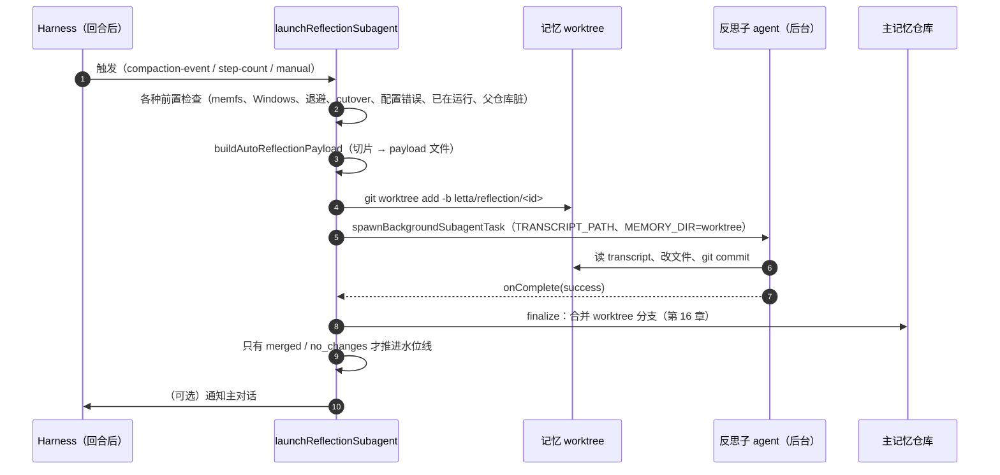

# 第 15 章 ★★ 反思子 agent：读经历、写记忆

> 本章目标：读懂 letta-code 启动一次反思的完整流程、反思子 agent 的五阶段提示词，以及“一次反思算成功”的判定为什么必须很严格。实现 mini-letta 的反思，并用真模型把它逼出两种失败模式。前置：第 14 章。对应代码：mini-letta `v0.5` `src/reflection/{launcher,prompt}.ts`、`src/llm/mock-reflection.ts`。

## 15.1 一次反思的生命周期



## 15.2 启动前的关卡

`launchReflectionSubagent()`（`src/cli/helpers/reflection-launcher.ts:769`）在真正启动前依次检查：

| 关卡 | 不通过时返回 | 为什么 |
|---|---|---|
| MemFS 未启用 | `memfs_disabled` | 没有记忆仓库可写 |
| 自动反思且在 Windows | `windows_disabled` | 宿主策略（第 14 章） |
| 处于重试退避期 | `retry_backoff` | 上次**集成**失败后，等待 1 分钟起、每次翻倍、最多 30 分钟（`src/cli/helpers/reflection-retry.ts`） |
| Cloud 已接管反思（cutover） | `cutover` | 服务器端反思负责这个 agent 时，客户端不重复做 |
| 模型配置错误被记录过 | `configuration_error` | 同一个坏配置不要反复失败 |
| 同一个 agent 已有反思在跑 | `already_active` | 每个 agent 同时只能一个；新请求**排队**，等当前这次结束 |
| 父记忆仓库有未提交改动 | `parent_dirty` | 合并时会冲突，干脆不开始 |
| 没有新内容 | `no_payload` | 水位线之后什么都没有 |

全部通过后：`buildAutoReflectionPayload()` 写 payload，`prepareReflectionMemoryWorktreeLaunch()`（`:526`）创建 worktree 并拼好任务提示，`spawnBackgroundSubagentTask()` 以 `subagentType: "reflection"`、`silentCompletion: true` 在后台启动子 agent，传入 `transcriptPath` 和 `memoryScope`（worktree 可写、父目录只读，第 16、19 章）。

## 15.3 子 agent 看到什么

**系统提示**：`src/agent/subagents/builtin/reflection-v2.md`（v2 布局用这一份）。frontmatter 规定了工具：

```markdown
---
name: reflection
description: Background agent that reflects on recent conversations to update memory and maintain skills
tools: Bash, Edit
model: inherit
launchProfile: memory-subagent
---
```

**任务提示**：`buildReflectionSubagentPrompt()`（`src/cli/helpers/reflection-prompt.ts:9`）——告诉它 payload 在 `$TRANSCRIPT_PATH`（只在 bash 里展开）、只能在 `$MEMORY_DIR` 里 `git add/commit`、Edit 要用绝对路径；最后附上**父 agent 当前记忆的快照**（`buildMemfsV2ParentMemorySnapshot()`，`src/cli/helpers/reflection-memory-v2.ts:43`）：投影出来的文件树，加上每个 core 文件的全文，总长不超过 40 000 字符（`REFLECTION_PARENT_MEMORY_SNAPSHOT_CHAR_LIMIT`，`src/agent/subagents/context-budget.ts:20`）。

子 agent 需要知道父 agent“已经记住了什么”，才能去重、才能把新信息放到正确的地方。

## 15.4 五阶段提示词

`reflection-v2.md` 是本书读过的最好的提示词之一。骨架：

**工具纪律**（`:22` 起）。只有 Bash 和 Edit；改已有文件必须用 Edit，不准用 heredoc 重写；Edit 路径必须先用 `printf "%s/persona.md\n" "$MEMORY_DIR"` 解析成绝对路径；读 transcript 要“有界”：

> Determine file size first… If a file is <= 15000 bytes, a full read is okay; otherwise use targeted reads (`head`, `tail`, `grep`, and `sed -n`…).（`:32`）

临时文件只能放在 `$MEMORY_DIR/.tmp/` 并在提交前删除（`:34`）——因为在沙箱里（第 19 章），根文件系统是只读的，`/tmp` 不可写。

**Phase 1 — Investigate**（`:62`）。先看父记忆的结构；按描述决定读哪些按需文件和技能。

**Phase 2 — Extract**（`:70` 起）。优先级：错误与纠正 > 偏好与模式 > 新事实 > 矛盾 > 可复用流程。每个候选过一遍过滤器：

> **Lasting or ephemeral?** One-off details tied to a single session — specific line numbers, exact error messages, temporary file paths, debug ports, intermediate calculations… are ephemeral. Don't store them.（`:82`）

还有：已经记过了吗？能否泛化？相对日期换成绝对日期；是记忆还是技能？“If nothing survives filtering, make no changes”（`:88`）。

**Phase 3 — Update**（`:90`）。放对层级（根目录要精简）；更新已有条目而不是追加重复；矛盾在源头修正；人格文件“外科手术式”修改；`ARCHIVE.md` 用来退役不再重要的内容；技能操作六选一（update / extend / deprecate / split / create / none），拿不准时选 none。

**Phase 4 — Review**（`:156`）。无密钥、无垃圾；交叉引用完整；层级检查（该常驻的常驻、不该的下放）。

**Phase 5 — Commit**（`:176`）。固定格式，带 trailer：

```text
<type>(reflection): <summary> 🔮

Reviewed transcript: <transcript_filepath>

Updates:
- <what changed and why>

Generated-By: Letta Code
Agent-ID: <CHILD_AGENT_ID>
Parent-Agent-ID: <PARENT_AGENT_ID>
```

“If no changes were needed, do NOT commit”，以及（`:211`）：“uncommitted edits are not successful memory persistence”。

## 15.5 mini-letta 的实现

**提示词**（`src/reflection/prompt.ts`）：五阶段的压缩版，`{CORE_MEMORY}` 放在最后。巧妙之处在于：反思子 agent 的 `memoryDir` 就是 worktree，而 worktree 的 HEAD 就是父记忆的当前版本——所以第 8 章的编译器把**父 agent 的记忆**编译进了子 agent 的系统提示。不需要单独的快照函数。

**启动器**（`src/reflection/launcher.ts`）：

```ts
// code/mini-letta @ v1.0  src/reflection/launcher.ts（节选）
const release = tryAcquireLock(join(agentDir(agent.id, home), "reflection.lock"));
if (!release) return { launched: false, reason: "already_active" };
try {
  if (git(parentMemoryDir, ["status", "--porcelain"]).stdout.trim()) return { launched: false, reason: "parent_dirty" };
  const payload = buildReflectionPayload(store, join(agentDir(agent.id, home), "reflections", "payloads"));
  if (!payload) return { launched: false, reason: "no_payload" };
  const worktree = createMemoryWorktree(parentMemoryDir);
  const reflector: AgentRecord = { id: `${agent.id}~reflection`, name: "Reflection Subagent",
                                   system: REFLECTION_SYSTEM_PROMPT, createdAt: new Date().toISOString() };
  // ... runTurn(reflector, memoryDir: worktree.worktreeDir,
  //             extraEnv: { TRANSCRIPT_PATH, PARENT_AGENT_ID }, tools: [bash, edit_file], maxSteps: 12)
  const finalized = await finalizeMemoryWorktree(worktree, { subagentSucceeded: succeeded });
  if (consumesTranscript(finalized)) markReflected(store, payload.endMessageId);
  if (finalized.status === "merged") syncAfterTurn(parentMemoryDir);
  return { launched: true, status: finalized.status, ... };
} finally {
  release();
}
```

与 letta-code 的差别：在进程内同步运行（不是独立的后台进程）；没有退避、cutover、配置错误抑制；`already_active` 直接拒绝而不排队；子 agent 的 id 用 `<parent>~reflection`，第 19 章的路径守卫据此认出它是“替父 agent 干活的”。

**mock 反思者**（`src/llm/mock-reflection.ts`）是五阶段的确定性替身：第一步 `wc -c "$TRANSCRIPT_PATH" && cat "$TRANSCRIPT_PATH"`；第二步从用户消息里挑出“持久的偏好”（匹配“我更喜欢 / 以后 / 别再 / 一律 / prefer / always / never…”），跳过一次性的请求，跳过父记忆里已有的，把“今天/昨天”换成绝对日期，追加到 `human.md` 并以 `Reflection Subagent` 的身份提交；没有可记的就不提交。

## 15.6 运行与验证

```text
$ bun src/cli.ts chat -p "帮我看下这个报错"
$ bun src/cli.ts chat -p "我更喜欢用 tabs 缩进"
$ bun src/cli.ts chat -p "今天我们决定以后一律用 pnpm"
  ☾ reflection 20261008160658-c0ef7940: merged — Merged 1 reflection commit(s).
$ bun src/cli.ts memory log
ce3d32f (HEAD -> main) chore(reflection): remember 2 user preference(s) 🔮
3263336 chore: initialize local memory
$ cat "$(bun src/cli.ts memory path)/human.md"
---
name: Human
description: What I know about the user.
---

- 我更喜欢用 tabs 缩进
- 2026-10-08我们决定以后一律用 pnpm
$ bun src/cli.ts chat -p "你知道我什么？"
  ↻ memory changed — injected <memory_update> reminder
我记得关于你的这些：
- 我更喜欢用 tabs 缩进
- 2026-10-08我们决定以后一律用 pnpm
```

“帮我看下这个报错”被正确地跳过了（一次性请求）；主对话在下一回合通过 `<memory_update>` 得知了反思的成果。

### 踩坑记录 1：“今天”是哪天

上面那次运行发生在本地时间 2026-10-09 00:06（UTC+8），记忆里却写着 `2026-10-08`——mock 用 `toISOString()` 取的是 **UTC** 日期。用户说的“今天”是用户日历上的今天。修复：按本地时区格式化（`localDate()`），顺手在日期后加了个空格，并补了一个“凌晨 00:06”的测试：

```ts
const lateNight = new Date(2026, 9, 9, 0, 6); // 00:06 local on Oct 9
expect(localDate(lateNight)).toBe("2026-10-09");
```

这对真实的反思提示词同样重要：“Convert any relative dates… to absolute dates”——模型需要知道**用户所在时区的**当前日期。

### 踩坑记录 2：真模型的空反思被当成了成功

把反思者换成 `qwen2.5:3b`（`MINI_LETTA_PROVIDER=openai bun src/cli.ts reflect`）：

```text
  ☾ reflection 20261008160804-fcf087b4: no_changes — Reflection made no memory commits.
```

看起来没问题——“看过了，没什么可记的”。但子 agent 的对话记录是：

```text
USER  …Run git add/commit only from $MEMORY_DIR; the harness integrates after your commit.
ASSISTANT  ""        （空回复，没有工具调用）
```

它什么都没做。而我们的启动器把“没有抛异常、没有用完步数”当成成功 → `no_changes` → **水位线前进，这段对话被标记为已反思，永远不会再被看一遍。**

第一次修复：空的最终报告算失败。再跑一次，qwen 换了一种失败方式：

```text
ASSISTANT  To proceed with the reflection phase, I will first review the conversation transcript and then
update the memory files accordingly. Given the constraints, I will not execute any git commands directly
here, … I will now proceed to read the transcript file and prepare the necessary updates.
（没有工具调用，回合结束）
```

非空，但**只说不做**——它声称要去读 transcript，却从没调用任何工具。结果又是 `no_changes`。

第二次修复：**“无需修改”必须有证据**——反思者至少要有一次工具调用引用了 `TRANSCRIPT_PATH` 或 payload 文件：

```ts
// code/mini-letta @ v0.5  src/reflection/launcher.ts（节选）
// "Nothing worth keeping" must be earned: the reflector has to have read
// the payload. qwen2.5:3b once only narrated "I will now read the
// transcript" and stopped, which would otherwise consume the slice.
let readPayload = false;
const onEvent = (event: TurnEvent) => {
  if (event.type === "tool_call" && JSON.stringify(event.arguments).match(/TRANSCRIPT_PATH|payload-\d+\.json/)) {
    readPayload = true;
  }
};
...
succeeded = readPayload && report.trim() !== "" && !report.startsWith("(stopped");
```

修复后，同样的弱模型得到的是可重试的 `failed`，随后用 mock（代表一个更强的模型）重跑，**同一段**对话被正确反思：

```text
  ☾ reflection 20261008160938-845487b4: failed — Reflection did not complete; the transcript can be retried.
  ⚙ bash({"command":"wc -c \"$TRANSCRIPT_PATH\" && cat \"$TRANSCRIPT_PATH\""})
  ⚙ bash({"command":"cd \"$MEMORY_DIR\" && printf '%s\\n' '- 我更喜欢用 tabs 缩进' >> human.md && ..."})
  ☾ reflection 20261008160940-ebda63df: merged — Merged 1 reflection commit(s).
```

两个回归测试：`an empty reflection is a failure: the slice stays unreflected`、`a reflector that never reads the payload has not reflected`。

**letta-code 会不会有同样的问题？** 我们**没有验证**。在 letta-code 里，“成功”来自后台子 agent 任务的完成状态：`spawnBackgroundSubagentTask()` 的 `onComplete({ success })`，经 `finalizeReflectionMemoryWorktreeLaunch()`（`reflection-launcher.ts:565`）变成 `shouldMerge: params.subagentSuccess`；`success && commitCount === 0` 即 `no_changes`，而 `no_changes` 会消费 transcript（`reflectionIntegrationConsumesTranscript()`，`src/agent/memory-worktree.ts:235`）。如果你在用弱模型做反思，值得确认一下子 agent“完成”的判定里是否检查了它真的读过 payload。

### 踩坑记录 3：反思者把自己读过的东西压缩掉了

Lab 6 的演示脚本一开始让反思者和主 agent 共用一个 1 400 token 的小窗口，结果**每一次**反思都是 `failed`。反思者的对话记录里，同一条命令重复了 12 次：

```text
assistant  [bash: wc -c "$TRANSCRIPT_PATH" && cat "$TRANSCRIPT_PATH"]
tool       1644 /…/payload-….json [...]           ← 1 676 字符的 transcript
user       {"type":"system_alert","message":"Note: 3 messages … hidden …"}   ← 压缩！
assistant  [bash: wc -c "$TRANSCRIPT_PATH" && cat "$TRANSCRIPT_PATH"]      ← 又读一遍
...
```

transcript 刚读进来，上下文就满了，压缩把它摘要掉；反思者“忘了”自己读过，再读；循环直到步数用完。两条教训，都和 letta-code 的设计吻合：反思应该能用**自己的模型和窗口**（`model: inherit` 只是默认值，可以配置），以及 reflection-v2.md 里那条“有界读取”的规则。演示脚本最后给反思单独配了一个窗口正常的 provider。

## 15.7 练习

1. **巩固**：给 mock 反思者加一种情况：用户说“别再叫我小陆了，叫我陆工”时，**修改**已有的那行而不是追加新行（Phase 3 的“在源头修正矛盾”）。
2. **扩展**：实现 letta-code 的重试退避：集成失败（`parent_dirty`、`merge_conflict`）后 1 分钟内不再自动反思，每次失败翻倍，最长 30 分钟；手动 `reflect` 不受限制。
3. **读源码**：letta-code 有一个 `merge: "explicit"` 模式（`runExplicitReflectionIntegration()`，`reflection-launcher.ts:458`）：反思完成后，不是由 harness 直接合并，而是在一个“集成对话”里让**主 agent 自己**审阅并合并反思分支。为什么会需要这种模式？它的 `requireAlreadyMerged` 检查（`memory-worktree.ts` 的 `finalizeReflectionMemoryWorktreeUnlocked`）在防什么？
