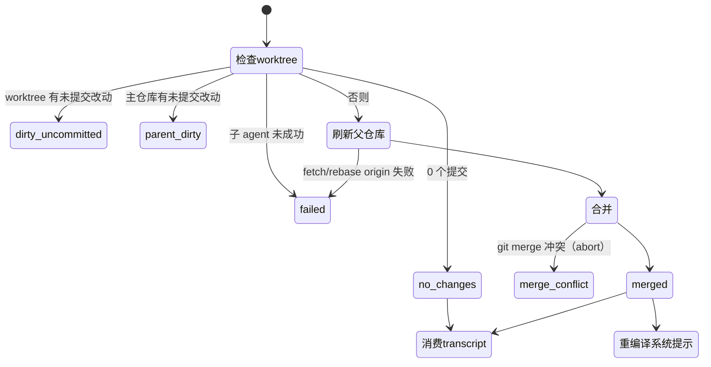

# 第 16 章 ★★ worktree 隔离与合并状态机

> 本章目标：理解为什么后台写者要在 git worktree 里工作；逐个状态读懂反思收尾的状态机（merged / no_changes / parent_dirty / merge_conflict / dirty_uncommitted / failed）以及“哪些状态消费 transcript”；看一个只在真实用户机器上才会出现的坑：全局 `core.autocrlf`。前置：第 6、15 章。对应代码：mini-letta `v0.5` `src/reflection/worktree.ts`。

## 16.1 为什么不直接在主仓库里改

反思在后台跑，可能要几十秒到几分钟。这期间主 agent 可能正在同一个仓库里改 `human.md`、用户可能手动编辑、另一台机器的改动可能被拉下来。如果反思直接在主检出上工作：

- 它的半成品会被主 agent 的 `git add` 意外带走（或者反过来）；
- 它失败了，留下的脏文件要有人收拾；
- 它和主 agent 同时提交，谁覆盖谁说不清。

git worktree 正好解决这个问题：**同一个仓库的第二个检出**，有自己的工作区、自己的暂存区、自己的分支，但共享对象库和 hook。反思在里面随便折腾，成功了合并回来，失败了整个删掉。

## 16.2 创建 worktree

```ts
// src/agent/memory-worktree.ts:125-171（节选）
const parentMemoryDir = resolve(options.parentMemoryDir);
const id = buildReflectionWorktreeId(options.now);                 // 20261008160658-c0ef7940
const worktreeBaseDir = join(dirname(parentMemoryDir), "memory-worktrees");
const label = options.label ?? "reflection";                       // memory worker 用 "memory-worker"
const worktreeDir = join(worktreeBaseDir, `${label}-${id}`);
const branchName = `letta/${label}/${id}`;
await mkdir(worktreeBaseDir, { recursive: true });
const baseHead = (await runGit(parentMemoryDir, ["rev-parse", "--verify", "HEAD"])).stdout.trim();
await runGit(parentMemoryDir, ["worktree", "add", worktreeDir, "-b", branchName, baseHead]);
```

记下 `baseHead`——收尾时用 `baseHead..HEAD` 数反思做了几个提交。worktree 放在记忆仓库的**兄弟目录**，而不是里面，免得 worktree 被当成记忆文件。

子 agent 拿到的“记忆作用域”（`buildReflectionMemoryScope()`，`:191`）：可写的是 worktree 和 git 公共目录（提交要写对象库），父目录只读。第 19 章会看到这些路径如何变成内核沙箱的挂载规则。

## 16.3 收尾状态机

`finalizeReflectionMemoryWorktreeUnlocked()`（`:363`）按固定顺序检查，每条路径都清理 worktree 和分支：



| 状态 | 条件 | 消费 transcript？ | 为什么 |
|---|---|---|---|
| `dirty_uncommitted` | worktree 里有没提交的改动 | 否 | 没提交的不算数（第 6 章）；也说明子 agent 没按流程走完 |
| `failed` | 子 agent 报告失败 | 否 | 即使它提交了东西也不合并——不能信任一个失败者的半成品 |
| `no_changes` | 成功且 0 个提交 | **是** | “看过了，没什么值得记的”也是一个结论 |
| `parent_dirty` | 主仓库工作区不干净 | 否 | 合并可能覆盖别人的未提交改动；稍后重试 |
| `merge_conflict` | 合并冲突 | 否 | `git merge --abort`，主仓库原样不动；重试时子 agent 会看到新的主仓库状态 |
| `merged` | 合并成功 | **是** | 唯一真正改变了记忆的结果，同时触发重编译 |

两个判定函数把这张表写成了代码：

```ts
// src/agent/memory-worktree.ts:235-245
export function reflectionIntegrationConsumesTranscript(result) {
  return result.status === "merged" || result.status === "no_changes";
}
export function reflectionIntegrationShouldRecompile(result) {
  return result.status === "merged";
}
```

注意不消费 transcript 的那四个状态全都是“**可重试**”的：清理干净，水位线不动，下次触发时同一段对话会被重新反思。这是整个设计最重要的性质——**失败不会丢失经历**。

合并本身就是一句 `git merge <branch> -m "merge(reflection): <摘要>"`。如果主仓库在反思期间没动过，git 会做快进（fast-forward），那条合并信息根本用不上；只有主仓库也前进了，才会产生一个真正的 `merge(reflection): …` 提交。

在合并之前还有一步 `refreshParentFromOrigin()`（`:275`）：如果配置了远端，先 fetch，再快进或 rebase 到 `origin/main`，让合并发生在“其他机器已经推上去的东西”之上（第 18 章）。

整个收尾在“记忆操作锁”里进行（`finalizeReflectionMemoryWorktree()` = `withMemoryOperation(…, finalizeReflectionMemoryWorktreeUnlocked)`，`:659`），第 17 章讲这把锁。

## 16.4 mini-letta 的实现

`src/reflection/worktree.ts` 是上面的直译，检查顺序完全相同：

```ts
// code/mini-letta @ v1.0  src/reflection/worktree.ts（节选）
return withLock(memoryOperationLockPath(worktree.parentMemoryDir), async () => {
  const commitCount = Number(git(worktree.worktreeDir, ["rev-list", "--count", `${worktree.baseHead}..HEAD`]).stdout.trim() || "0");
  const done = (status, summary) => { cleanup(worktree); return { status, commitCount, head, summary }; };
  if (porcelain(worktree.worktreeDir)) return done("dirty_uncommitted", "...");
  if (!options.subagentSucceeded) return done("failed", "...");
  if (commitCount === 0) return done("no_changes", "Reflection made no memory commits.");
  if (porcelain(worktree.parentMemoryDir)) return done("parent_dirty", "...");
  try { refreshFromOrigin(worktree.parentMemoryDir); }               // v1.0 加入
  catch { return done("failed", "Parent memory could not be refreshed from the remote; ..."); }
  const subject = git(worktree.parentMemoryDir, ["log", "-1", "--format=%s", worktree.branchName]).stdout.trim();
  const summary = subject.replace(/^[a-z]+(?:\([^)]+\))?!?:\s*/i, "") || "reflection memory updates";
  const merge = git(worktree.parentMemoryDir, ["merge", "--no-edit", "-m", `merge(reflection): ${summary}`, worktree.branchName]);
  if (!merge.ok) {
    git(worktree.parentMemoryDir, ["merge", "--abort"]);
    return done("merge_conflict", "...");
  }
  ...
  return { status: "merged", ... };
});
```

hook 在 worktree 里同样生效：hook 文件在 git 公共目录的 `hooks/` 下，我们的 pre-commit 用 `git rev-parse --git-common-dir` 找 validator（第 7 章）。所以反思子 agent 的每一次提交也要过 frontmatter 与预算检查。

## 16.5 运行与验证：把每个状态都造出来

`test/v05-reflection.test.ts` 用真实的 git 操作逐个制造六种状态：

```ts
const noop = createMemoryWorktree(memoryDir);
expect((await finalizeMemoryWorktree(noop, { subagentSucceeded: true })).status).toBe("no_changes");
expect(existsSync(noop.worktreeDir)).toBe(false);                           // 清理了

const ok = createMemoryWorktree(memoryDir);
commitIn(ok.worktreeDir, "human.md", HUMAN("- likes tabs\n"), "chore(reflection): likes tabs");
expect((await finalizeMemoryWorktree(ok, { subagentSucceeded: true })).status).toBe("merged");
expect(git(memoryDir, ["branch", "--list", ok.branchName]).stdout).toBe("");  // 分支删了

const crashed = createMemoryWorktree(memoryDir);
commitIn(crashed.worktreeDir, ...);
expect((await finalizeMemoryWorktree(crashed, { subagentSucceeded: false })).status).toBe("failed");
// 提交了也不合并

// parent_dirty：主仓库里放一个未跟踪文件
// merge_conflict：反思分支和主仓库改了同一行
expect(conflict.status).toBe("merge_conflict");
expect(git(memoryDir, ["status", "--porcelain"]).stdout).toBe("");           // abort 干净
```

以及“冲突后用同一段对话重试成功”：测试里的 mock 在反思者读完 transcript 时，偷偷让“主 agent”提交一个冲突的改动；第一次 `merge_conflict`、水位线不动；第二次重试 `merged`，`human.md` 同时有两边的内容：

```ts
expect(first.launched && first.status).toBe("merge_conflict");
expect(stepsSinceLastReflection(store)).toBe(1);
const retry = await launchReflection({ ... });
expect(retry.launched && retry.status).toBe("merged");
expect(readFileSync(join(memoryDir, "human.md"), "utf8")).toContain("- edited by primary\n- 我更喜欢用 tabs 缩进");
```

## 16.6 踩坑记录：CRLF 从哪来的

上面最后一个断言第一次运行时失败了，失败信息让人一愣：

```text
Expected to contain: "- edited by primary\n- 我更喜欢用 tabs 缩进"
Received: "---\r\nname: Human\r\ndescription: What I know about the user.\r\n---\r\n- edited by primary\r\n- 我更喜欢用 tabs 缩进\r\n"
```

`\r\n`？这是 Linux。查了一下：

```text
$ git config --show-origin --get-all core.autocrlf
file:/home/luxiang/.gitconfig	true
```

这台机器的**全局** git 配置里开着 `core.autocrlf=true`。它的含义是：提交时把 CRLF 转成 LF，**检出时把 LF 转成 CRLF**。主仓库的文件是我们的代码直接写的（LF），而 worktree 和合并结果是 git **检出**的——于是带上了 CRLF。

这是第 6 章那句话的又一个例子：**记忆仓库住在用户机器上，用户的全局 git 配置会渗进来。** 修复是在初始化时把仓库级配置钉死：

```ts
// code/mini-letta @ v0.5  src/memory/memfs.ts
// Memory bytes must not depend on the host: a global core.autocrlf=true
// would check worktrees and merges out with CRLF.
gitOrThrow(memoryDir, ["config", "core.autocrlf", "false"]);
gitOrThrow(memoryDir, ["config", "core.eol", "lf"]);
```

后来做多机同步时（第 18 章），这个坑又咬了一次：`git clone` 在我们设置仓库级配置**之前**就已经按全局配置检出了 CRLF 文件，于是一个刚克隆下来的仓库立刻显示所有文件都被修改，hook 还因为 `---\r` 不等于 `---` 拒绝了提交。修复是把配置放进 clone 命令本身：`git clone --config core.autocrlf=false --config core.eol=lf`。

### letta-code 有没有这个问题？

我们去 letta-code 里找 `autocrlf`，只在测试辅助代码里找到（`src/test-utils/temp-git-repo.ts:28-29`）——测试用的临时仓库钉死了 LF，真实的记忆仓库没有。

第一次探针（在 letta-code 克隆里写一个 `bun test`）显示**没有** CRLF。但这次结论是错的：letta-code 的测试预加载脚本把 `HOME` 换成了临时目录（`scripts/test-home-preload.ts:48`），全局 `~/.gitconfig` 根本没被读到。改成用普通的 `bun` 脚本、在真实 `HOME` 下运行同样的逻辑（`LocalBackend` 创建 agent → `createReflectionMemoryWorktree()`）：

```text
HOME /home/luxiang
main checkout has CRLF: false
reflection worktree has CRLF: true
```

在 `70ead335`、全局 `core.autocrlf=true` 的机器上，letta-code 的反思 worktree 里的记忆文件是 CRLF 的。主检出是 LF（文件由代码直接写入）。后果取决于后续的工具怎么处理：git 在提交时会把 CRLF 转回 LF，所以对象库里大概率是干净的；但反思子 agent 用 Edit 工具读到的是 CRLF 文本。我们没有继续追踪它在端到端流程里的全部影响，只陈述观察到的现象。

两个通用教训：

1. 任何“在用户机器上替用户管理一个 git 仓库”的程序，都应该显式设置那些会影响字节的仓库级配置（`core.autocrlf`、`core.eol`、`commit.gpgsign`……），而且要在**检出发生之前**设置。
2. 测试环境隔离（换 `HOME`）是好习惯，但它也会**隐藏**只在真实环境里出现的问题。探针要在真实环境里再跑一次。

## 16.7 练习

1. **巩固**：在 mini-letta 里手工制造 `parent_dirty`：在主仓库里留一个未跟踪文件，然后 `bun src/cli.ts reflect`。返回的是什么？为什么启动器在**开始**时就检查一次父仓库是否干净（`reason: "parent_dirty"`），收尾时还要再检查一次？
2. **扩展**：letta-code 的 memory worker 收尾（`integrateMemoryWorkerWorktree()`，`src/agent/memory-worktree.ts:685`）和反思不同：主仓库脏**不**阻止合并，冲突时**保留**分支。读它的注释，说说为什么两种后台写者的策略不一样，然后给 mini-letta 实现一个 memory worker。
3. **读源码**：`cleanupWorktreeAndBranch()`（`:340`）删分支时，成功合并用 `branch -d`，失败路径用 `branch -D`（`force`）。这个区别在防什么？
