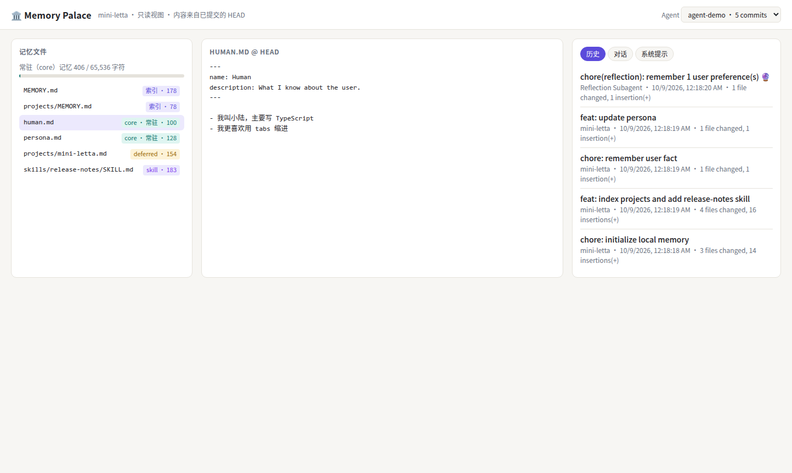
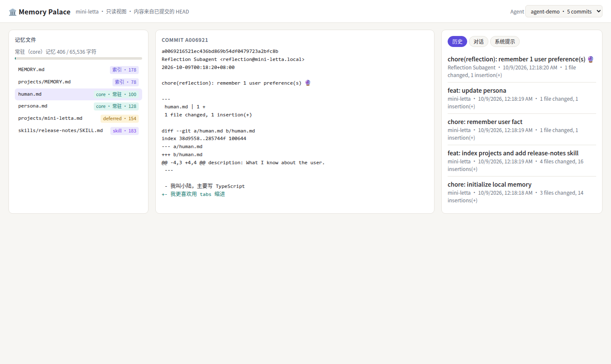
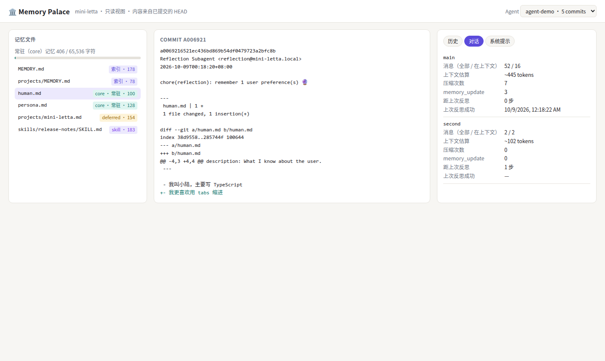
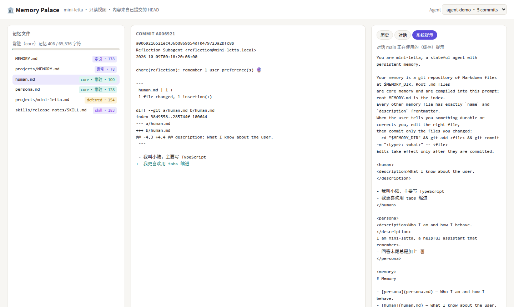

# 第 20 章 观察与调试记忆：Memory Palace、/doctor 与审计

> 本章目标：一个会自己改记忆的 agent，必须让人能看清它的记忆“现在是什么样、怎么变成这样的、对话正在用哪个版本”。读 letta-code 的 `/palace` 和 `/doctor`，实现 mini-letta 的 Memory Palace 网页。前置：全书。对应代码：mini-letta `v1.0` `src/palace/*`。

## 20.1 要回答哪些问题

调试一个“为什么它不记得”的问题时，需要依次回答：

1. **记忆里有没有？**——看 HEAD 里的文件；
2. **在不在常驻层？**——它是根目录的 core 文件，还是藏在某个按需目录里？
3. **是什么时候、谁写进去的？**——git log，区分用户、agent、反思；
4. **这个对话用的是哪个版本？**——对话缓存的系统提示 vs 最新编译结果；有没有待注入的 `<memory_update>`；
5. **有没有被压缩掉？反思到哪了？**——上下文 id 列表、摘要次数、反思水位线；
6. **记忆健康吗？**——预算、格式、未提交的改动。

## 20.2 letta-code 的工具

**`/palace`**（`src/cli/commands/registry.ts:139`，“Open the Memory Palace in your browser”）。`src/web/generate-memory-viewer.ts` 收集数据，注入一个自包含的 HTML 模板（`memory-viewer-template.txt`，约 108 KB），写到 `~/.letta/viewers/`（`:41`）再用浏览器打开。数据包括：记忆文件、最多 500 个提交（最近 50 个带完整 diff，单个 diff 100 KB、总共 5 MB 封顶）、上下文用量、对话与消息。提交会被标记是否来自反思：

```ts
// src/web/generate-memory-viewer.ts:295
const REFLECTION_PATTERN = /\(reflection\)|🔮|reflection:/i;
```

这就是为什么反思提示词要求提交信息里带 `(reflection)` 和 🔮（第 15 章）——提交格式是一种给可观察性用的**协议**。

**`/doctor [symptom]`**（`registry.ts:77`）加载 `context-doctor` 技能：“Investigate and repair an agent's context — memory, system prompt, and skills — using observed behavior as evidence.”它把第 10 章那条要求（被问“你为什么没记住”时，把它当作上下文工程问题来诊断）变成了一个可调用的流程。系统提示里“The harness flags your system prompt for `/doctor` when it grows too large”指的就是它。

**审计**：`validateMemoryConstraintsHead()`（第 7 章）也可以单独运行，检查已提交的树是否健康。

**遥测**：每次反思发出 `reflection_start` / `reflection_end` 事件（`emitReflectionRunStart/End()`，`reflection-launcher.ts:170/188`），带触发源、成功与否、步数、耗时、模型——反思质量问题（比如第 15 章那种“空反思”）在统计上是可见的。

## 20.3 mini-letta 的 Memory Palace

letta-code 生成静态文件；mini-letta 起一个只读的小服务器（`bun src/cli.ts palace`），这样它也能作为 Lab 6 里部署的服务。三个文件：

- `src/palace/data.ts`：所有视图的数据函数（只读）；
- `src/palace/server.ts`：`Bun.serve`，只接受 GET，路由到上面的函数；
- `src/palace/page.ts`：一个无构建步骤的单页（原生 JS + CSS 变量，支持暗色模式、窄屏）。

数据层的核心是“分类”：每个文件按第 5 章的规则标出它在哪一层：

```ts
// code/mini-letta @ v1.0  src/palace/data.ts（节选）
function classify(path: string, all: Set<string>): FileKind {
  if (path.startsWith("skills/")) return "skill";
  if (!path.endsWith(".md")) return "other";
  if (path === "MEMORY.md" || path.endsWith("/MEMORY.md")) return isProjectedMemoryPath(path, all) ? "index" : "unindexed";
  if (isCoreMemoryPath(path)) return "core";
  return isProjectedMemoryPath(path, all) ? "deferred" : "unindexed";
}
```

对话视图回答 20.1 的第 4、5 个问题：

```ts
return {
  id, messages: all.length, inContext: inContext.length,
  contextTokens: estimateMessagesTokens(inContext),
  compactions: all.filter((m) => m.kind === "summary").length,
  memoryUpdates: all.filter((m) => m.content.includes("<memory_update>")).length,
  stepsSinceReflection: stepsSinceLastReflection(store),
  lastReflectionSucceededAt: state.lastReflectionSucceededAt ?? null,
  // Committed memory moved since this conversation last looked: the next step injects <memory_update>.
  updatePending: Boolean(cached && cached.memfsRevision !== head),
  ...
};
```

提交视图用和 letta-code 一样的思路标记反思提交；`commit` 接口只接受 7–40 位十六进制的 sha（拒绝 `;rm` 之类的输入），所有接口只读，非 GET 返回 405。

## 20.4 运行与验证

```bash
export MINI_LETTA_HOME=$(mktemp -d)
bun scripts/demo.ts          # 生成一个有核心/索引/按需/技能、压缩、反思、recall 的演示状态
bun src/cli.ts palace --port 8787
```

用 headless Chrome（`playwright-core` + 系统的 `google-chrome`）截的图，数据来自演示脚本：



*图 20-1：左栏按层级列出记忆文件（索引 / core·常驻 / deferred / skill）及字符数，顶部是常驻记忆占预算的比例（406 / 65 536 字符）；中间是 HEAD 上的 `human.md`；右栏是提交历史，最上面一条是反思提交。*



*图 20-2：点开反思提交，看到作者是 Reflection Subagent，改动是 `human.md` 里新增的一行“我更喜欢用 tabs 缩进”。*



*图 20-3：对话 `main` 共 52 条消息、只有 16 条在上下文里，压缩过 7 次，收到过 3 次 `<memory_update>`，刚刚反思过；对话 `second` 是新开的，只有 2 条消息。*



*图 20-4：对话 `main` 当前缓存的系统提示——经过多次压缩后的完整重编译，已经包含了 persona 里的 🦉 规则和反思写入的 tabs 偏好。*

截图脚本同时检查了：页面没有 JS 错误（第一次跑时有一个 404，是浏览器请求 `/favicon.ico`，后来让它返回 204），以及 390px 宽度下没有横向滚动。

一个单元测试锁定了分类与只读语义（`test/v10-palace.test.ts`）：

```ts
expect(kinds).toEqual({
  "MEMORY.md": "index", "human.md": "core", "persona.md": "core",
  "projects/MEMORY.md": "index", "projects/a.md": "deferred",
});
expect((await fetch(`${base}/api/agents/agent-p/tree`, { method: "POST" })).status).toBe(405);
expect((await fetch(`${base}/api/agents/agent-p/commit?sha=;rm`)).status).toBe(404);
```

## 20.5 用 Palace 调试一次

回到第 9 章 qwen 的那次实验（“Hoot”只在同一对话里有效）。如果当时有 Palace：

1. 左栏顶部会出现红色的“未提交 2”——`persona.md` 被改了但没提交，`Memory.md` 是未跟踪文件；
2. 提交历史里只有初始化提交；
3. 对话视图里 `memory_update` 为 0。

三条信息合起来，结论一目了然：**记忆从来没有生效过**，同一对话里的 “Hoot” 只是上下文里的原话在起作用。这比读几百行 JSONL 快得多。

## 20.6 练习

1. **巩固**：在 Palace 的对话视图里加一列“上次压缩时间”，数据来自 `compaction-event.json`。
2. **扩展**：实现一个 `/doctor` 式的检查命令 `bun src/cli.ts doctor`，输出：未提交改动、审计结果、超预算的文件、断掉的 `MEMORY.md` 链接、长期没反思的对话（`stepsSinceReflection > 50`）。
3. **读源码**：读 `src/skills/builtin/context-doctor/SKILL.md`。它把“诊断”分成了哪几步？哪些步骤是 mini-letta 的 Palace 已经能提供证据的？
