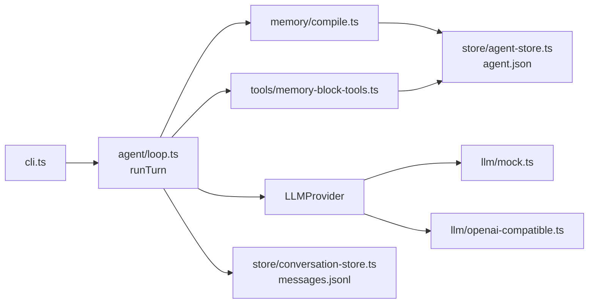

# Lab 1 mini-letta v0.1：能对话、记忆块进系统提示

> 目标：从空目录写出一个能跑的最小 stateful agent——agent loop、可替换的模型接口、一个确定性的 mock 模型、两个记忆块编译进系统提示、一个 CLI。前置：第 1–3 章。完成后：`git checkout v0.1` 的样子。

## L1.1 要做的东西



文件不多，每个都短：

```text
src/
├── cli.ts                      命令行：chat / prompt / agents
├── agent/loop.ts               一个回合：调用模型 → 执行工具 → 再调用 … 直到没有工具调用
├── llm/types.ts                Message / ToolCall / LLMProvider
├── llm/mock.ts                 确定性的 mock 模型（规则表）
├── llm/openai-compatible.ts    OpenAI 兼容接口（Ollama 可用）
├── llm/provider.ts             按环境变量选择 provider
├── memory/compile.ts           记忆块 → 系统提示
├── store/{paths,agent-store,conversation-store}.ts
└── tools/{types,memory-block-tools}.ts
```

## L1.2 初始化项目

```bash
mkdir mini-letta && cd mini-letta && git init -b main
bun init -y            # 或者手写 package.json
bun add -d typescript @types/bun
```

`tsconfig.json` 开严格模式，并模仿 letta-code 用 `@/` 别名指向 `src/`（letta-code 禁止 `../` 相对父级导入，理由是 grep 友好）：

```json
{
  "compilerOptions": {
    "target": "ES2022", "module": "ESNext", "moduleResolution": "bundler",
    "strict": true, "noUnusedLocals": true, "noUnusedParameters": true,
    "types": ["bun"], "noEmit": true, "baseUrl": ".", "paths": { "@/*": ["src/*"] }
  },
  "include": ["src", "test"]
}
```

## L1.3 消息与模型接口

一个扁平的 `Message` 就够：角色、文本、可选的工具调用、可选的 `toolCallId`。

```ts
// src/llm/types.ts（节选）
export interface Message {
  id: string;
  role: "system" | "user" | "assistant" | "tool";
  content: string;
  toolCalls?: ToolCall[];   // assistant 请求工具
  toolCallId?: string;      // tool 消息回答哪一个调用
  createdAt: string;
}

export interface LLMProvider {
  readonly name: string;
  readonly contextWindow: number;   // Part IV 才用到
  complete(request: CompletionRequest, onText?: (delta: string) => void): Promise<CompletionResult>;
}
```

letta-code 把 provider 适配交给了 `@earendil-works/pi-ai`（CLAUDE.md 的 “pi-ai Ownership Boundary”），自己只负责“喂进去的是规范的消息”。我们只需要文本和工具调用，所以写一个 50 行的 OpenAI 兼容客户端（`src/llm/openai-compatible.ts`）就够了。

## L1.4 mock 模型：规则表

mock 模型的原则是：**只根据它“看见”的东西（系统提示 + 消息）作答**。这样它才能真实地反映记忆系统的效果——记忆没进上下文，它就不知道。

```ts
// src/llm/mock.ts（v0.1 节选）
const REMEMBER = /^(?:请)?(?:记住|remember)\s*[:：]?\s*(.+)$/is;
const WHO_AM_I = /我是谁|你(?:都)?知道我(?:什么|哪些)|关于我|what do you know about me/i;

/** "记住：X" → write X into the human block */
const rememberRule: MockRule = (request) => {
  if (lastMessage(request)?.role !== "user") return null;
  const fact = lastUserText(request).match(REMEMBER)?.[1]?.trim();
  if (!fact) return null;
  if (hasTool(request, "memory_append")) {
    return callTool("memory_append", { label: "human", content: `- ${fact}` });
  }
  return null;
};

/** "你知道我什么？" → answer only from what the compiled prompt contains. */
const whoAmIRule: MockRule = (request) => {
  if (lastMessage(request)?.role !== "user") return null;
  if (!WHO_AM_I.test(lastUserText(request))) return null;
  const human = promptSection(request.system, "human");
  return say(human && human !== "(nothing yet)" ? `我记得关于你的这些：\n${human}` : "我对你还一无所知。");
};
```

规则按顺序尝试：工具结果之后的确认句、“记住”、“你知道我什么”、兜底的回声。后续版本会往表里加压缩摘要、recall、反思等规则。

## L1.5 agent loop

一个“回合”（turn）= 用户说一句话，到 agent 给出不带工具调用的回复为止；其中每一次模型调用是一“步”（step）。letta-code 的反思触发器数的就是 step（第 14 章），所以从一开始就把它返回出来。

```ts
// src/agent/loop.ts（v0.1 节选）
store.append(makeMessage("user", input.userText));
for (let step = 1; step <= maxSteps; step++) {
  const history = store.all();
  // v0.1 recompiles every step, so a block edit is visible on the next step.
  systemPrompt = compileBlocksSystemPrompt({ agent, conversationId: store.conversationId,
                                             previousMessageCount: history.length });
  const result = await provider.complete({ system: systemPrompt, messages: history, tools: ... }, onText);
  store.append(makeMessage("assistant", result.content, { toolCalls: ... }));
  if (result.toolCalls.length === 0) return { steps: step, finalText: result.content, systemPrompt };
  for (const call of result.toolCalls) store.append(await executeTool(toolsByName.get(call.name), call, ctx));
}
```

工具出错不抛到外面，而是变成一条 `Error: ...` 开头的 tool 消息还给模型——让模型自己决定怎么办。

## L1.6 记忆块和编译

```ts
// src/memory/compile.ts（v0.1 节选）
export function injectCoreMemory(rawSystemPrompt: string, coreMemory: string): string {
  const prompt = rawSystemPrompt.includes(CORE_MEMORY_VARIABLE)
    ? rawSystemPrompt
    : `${rawSystemPrompt.trimEnd()}\n\n${CORE_MEMORY_VARIABLE}`;
  return prompt.replaceAll(CORE_MEMORY_VARIABLE, coreMemory);
}
```

这几行几乎逐字对应 letta-code 的 `injectCoreMemory()`（`src/backend/local/system-prompt-compilation.ts:380`）：系统提示里如果没有 `{CORE_MEMORY}`，就把记忆追加到末尾——这样用户自定义的系统提示也不会丢掉记忆。

`<memory_metadata>` 也照搬了 letta-code v1 布局时的写法（`system-prompt-compilation.ts:364`）：agent id、对话 id、编译时间、recall 里有多少条消息。

## L1.7 运行与验证

```bash
bun test          # v0.1：4 个测试
bunx tsc --noEmit
export MINI_LETTA_HOME=$(mktemp -d)
bun src/cli.ts chat -p "记住：我叫小陆，主要写 TypeScript"
bun src/cli.ts chat -p "你知道我什么？"
bun src/cli.ts prompt | tail -22
```

实际输出：

```text
  ⚙ memory_append({"label":"human","content":"- 我叫小陆，主要写 TypeScript"})
  ✓ Appended to human.
好的，我已经把这件事记进记忆里了。
我记得关于你的这些：
- 我叫小陆，主要写 TypeScript
You are mini-letta, a stateful agent with persistent memory.
...
<memory>
<persona>
<description>Who I am and how I behave.</description>
I am mini-letta, a helpful assistant that remembers.
</persona>

<human>
<description>What I know about the user.</description>
- 我叫小陆，主要写 TypeScript
</human>
</memory>

<memory_metadata>
- AGENT_ID: agent-default
- CONVERSATION_ID: default
- System prompt last recompiled: 2026-10-08T15:46:26.423Z
- 6 previous messages are stored in recall memory
</memory_metadata>
```

测试里最关键的一条断言是“一个回合两步”：第一步模型发出工具调用，第二步看到工具结果后作答，而**第二步的系统提示里已经有了新记忆**：

```ts
const first = await runTurn({ ..., userText: "记住：我用 pnpm 而不是 npm" });
expect(first.steps).toBe(2);
expect(first.systemPrompt).toContain("- 我用 pnpm 而不是 npm");
```

### 真模型

```bash
MINI_LETTA_PROVIDER=openai MINI_LETTA_MODEL=qwen2.5:3b \
  bun src/cli.ts chat -p "Please remember this about me: my name is Lu and I prefer pnpm over npm."
```

`qwen2.5:3b` 正确调用了 `memory_append`（输出见第 1 章）。工具越简单、参数越少，小模型越不容易出错——记住这一点，第 6 章换成“用 bash 改文件再 git commit”之后，同一个模型的表现会大不一样。

## L1.8 v0.1 故意留下的问题

- 每一步都重编译系统提示：对提示缓存极不友好；
- 记忆是 JSON 里的字符串：不能 diff、不能回滚、不能用 grep；
- 任何内容都能写进去：没有格式，没有预算；
- 消息无限增长。

接下来四个 Part 依次解决它们。

## L1.9 练习

1. **巩固**：给 mock 加一条规则：用户说“忘掉：X”时，调用 `memory_replace` 把 `- X` 替换为空串。写一个测试。
2. **扩展**：给 `runTurn` 加一个 `onEvent({ type: "step", n })` 事件，让 CLI 显示“第 n 步”。
3. **读源码**：letta-code 的回合执行器每一次 `execute()` 是一个“回合”还是一“步”？对照 `src/backend/dev/fake-headless-backend.ts:469` 的 `executeConversationTurn` 和客户端工具（approval）的机制想一想：工具在哪一侧执行？
